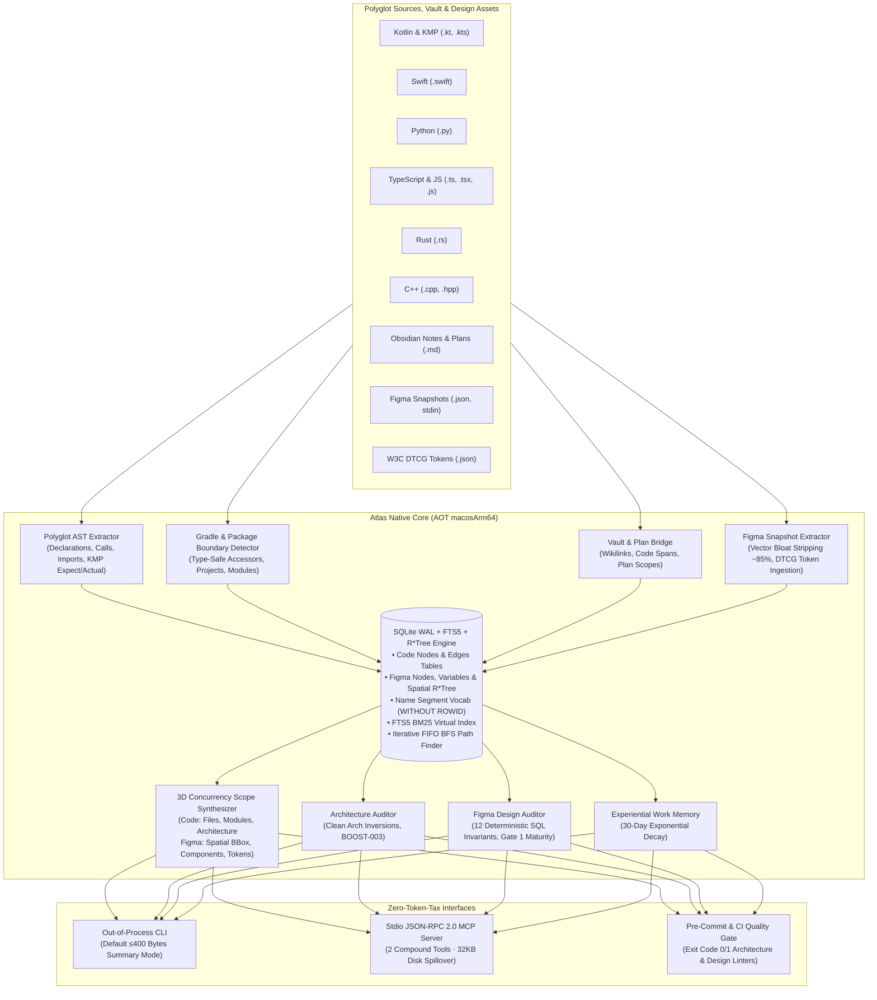

<div align="center">

# Atlas (`code-atlas`)

**Sovereign Polyglot AST, 3D Concurrency Scope & Code Graph Engine**

*Sub-15ms Cold-Start &middot; Ahead-Of-Time Native Binary &middot; Zero Runtime Dependencies &middot; Model Context Protocol (MCP)*

[](https://github.com/jefferyforbes/code-atlas/releases)
[](https://kotlinlang.org/docs/native-overview.html)
[-000000?logo=apple&logoColor=white)](https://apple.com)
[](https://github.com/jefferyforbes/code-atlas)
[](https://modelcontextprotocol.io)
[](LICENSE)

</div>

---

## Overview

AI coding and design agents waste thousands of prompt tokens repeatedly reading, parsing, and grepping raw source trees and heavy design files to answer basic questions like:
- *"What calls this function or instantiates this component?"*
- *"If I change this interface or design token, what breaks downstream?"*
- *"Does this pull request violate Clean Architecture layers or design system invariants?"*
- *"What files, modules, or canvas regions must be bounded so multiple agents do not collide?"*

**Atlas** solves this by providing a **sub-15ms polyglot AST and design knowledge graph engine** in a single standalone ~3.0 MB binary. Compiled ahead-of-time (AOT) via Kotlin/Native (`macosArm64`), Atlas links directly against system `libsqlite3` (`WAL` + `FTS5` + `R*Tree`), bypassing the Python virtualenv tax and JVM cold-start latency.

Starting in **v0.3.0**, Atlas expands beyond source code into **Figma Atlas (`atlas figma`)**: indexing Figma document snapshots and W3C Design Tokens (DTCG), querying 2D spatial layouts via R*Tree bounding boxes, running 12 deterministic SQL design audits, and synthesizing 3D Concurrency Scopes for autonomous design agents.

Whether invoked directly from your shell, embedded into git pre-commit hooks, or running as a background **Model Context Protocol (MCP)** server, Atlas provides deterministic codebase and design truth with minimal token consumption.

---

## Architectural Philosophy & Capabilities



### Key Pillars

1. **Polyglot AST Extraction**: Native AST tokenization for Kotlin (including `@Composable`, KMP `expect`/`actual` pairs), Swift, Python, TypeScript/JavaScript, Rust, and C++ with 0 LLM token cost.
2. **Sub-5ms Graph Traversal**: Iterative FIFO Breadth-First Search (BFS) computes directed shortest paths, caller trees, callee cones, and blast radii across 15,000+ edges in milliseconds.
3. **3D Concurrency Scope Synthesis**: Synthesizes exact 3D boundaries (`files`, `modules`, `architecture`) for AI agent orchestration (`/architect`, `/plan`, `/teamwork`), preventing collisions between concurrent task branches.
4. **Figma Spatial AST & 2D R\*Tree Indexing**: Parses Figma document node trees, stores geometric bounds into an SQLite `rtree` virtual table, and executes spatial overlap / containment queries (`--bounds x1,x2,y1,y2`) in $<1$ ms.
5. **Vector Bloat Stripping & W3C DTCG Token Ingestion**: Strips heavy SVG vector path and bezier payloads (~85% reduction) during ingestion, imports DTCG design token bundles, and resolves alias DAGs with cycle detection.
6. **12 Deterministic SQL Design Invariant Audits**: Evaluates UI layout sizing (circular `FILL` in `HUG`), touch targets ($\ge 48\times 48\,\text{dp}$), hardcoded ad-hoc colors/spacings, AA contrast ratios, and master component linkages.
7. **Clean Architecture & `BOOST-003` Auditor**: Enforces Clean Architecture layer boundaries (flagging illegal Domain $\to$ UI or Domain $\to$ concrete Data references) and the Single Declaration Principle (Rule 6: at most 1 top-level declaration per production file).
8. **Experiential Work Memory**: Attaches agent debugging outcomes (`useful`, `dead_end`, `corrected`) to graph nodes, weighted by an automated 30-day exponential decay half-life.
9. **Dual-Profile Enterprise Cache**: Stores the SQLite database in `~/Library/Caches/atlas/<repo_hash>/atlas.db` by default, keeping your git repository working tree 100% clean.
10. **Strict Token Economy**: CLI queries default to single-line summaries ($\le 400$ bytes) to preserve agent context windows. Large query results exceeding 32 KB automatically spill to disk artifacts with lightweight URI references.

---

## Performance Benchmarks

Measured on Apple Silicon M-Series (macOS 15 Sequoia):

| Metric | **Atlas Native** (`macosArm64`) | Python (`better-sqlite3`/`ast`) | JVM / Java (`gradle`) |
| :--- | :--- | :--- | :--- |
| **CLI Cold Start** | **~3 ms** (`0.003s`) | ~140–180 ms | ~1,200–2,500 ms |
| **Memory Footprint** | **~6 MB RSS** | ~45–60 MB RSS | ~250–400 MB RSS |
| **Code Index (812 files, 15k edges)** | **~5.2 seconds** | ~18.5 seconds | ~14.0 seconds |
| **Incremental Re-Index (Cache Hit)** | **~0.2 seconds** | ~1.4 seconds | ~3.8 seconds |
| **Figma Ingestion (10k nodes, DTCG)** | **~0.4 seconds** | ~3.2 seconds | ~2.5 seconds |
| **Figma Vector Bloat Reduction** | **~85% payload cut** | N/A | N/A |
| **2D Spatial R\*Tree Query** | **< 1 ms** | ~12 ms | ~8 ms |
| **12 SQL Design Audits** | **< 5 ms** | ~45 ms | ~25 ms |
| **BFS Shortest Path (16k edges)** | **< 4 ms** | ~35 ms | ~20 ms |
| **Binary Size** | **~3.0 MB** (standalone) | ~40 MB + virtualenv | ~65 MB + JDK |

---

## Installation

### Option 1: Quick Install (Recommended)

Download and install the native binary directly to your `~/.local/bin`:

```bash
mkdir -p ~/.local/bin
curl -sSL https://github.com/jefferyforbes/code-atlas/releases/latest/download/atlas-macos-arm64.tar.gz | tar -xz -C ~/.local/bin/
chmod +x ~/.local/bin/atlas

# Verify installation
atlas --version
atlas --help
```

### Option 2: Build From Source

Requirements: macOS (Apple Silicon), JDK 21 (Zulu LTS recommended).

```bash
git clone https://github.com/jefferyforbes/code-atlas.git
cd code-atlas

# Run native test suite
./gradlew macosArm64Test

# Build release binary and install to ~/.local/bin
./gradlew installToLocalBin

# Verify installation
atlas --version
atlas figma --help
```

---

## CLI Reference

### Global Options

```text
  --version, -v            Print version information
  --help, -h               Print help information
  --project <name>         Target project slug (default: organisation)
  --workspace <dir>        Workspace root directory (default: .)
  --db <path>              Custom SQLite database path
  --cache-profile <p>      'enterprise' (user cache) or 'in-repo' (.atlas/)
  --json                   Emit full formatted JSON output
  --summary                Emit compact summary <= 400 bytes (default)
```

---

### Code Commands

#### 1. `atlas index`
Incrementally scan and index repository source files and markdown contracts.

```bash
# Index current repository into user cache
atlas index --project my-project

# Index specific subdirectories
atlas index --project my-project --paths shared/ feature/cart/

# Emit full JSON metrics
atlas index --project my-project --json
```

#### 2. `atlas query`
Query symbols, call hierarchies, blast radii, or graph topologies.

```bash
# General symbol search
atlas query --action search --target "CartViewModel"

# Inspect symbol declaration coordinates and live source slice
atlas query --action symbol --target "ProductCard" --include-source

# Find incoming callers (who calls this?)
atlas query --action callers --target "formatPrice" --depth 2

# Find outgoing callees (what does this invoke?)
atlas query --action callees --target "CheckoutUseCase" --depth 2

# Compute blast radius impact cone
atlas query --action impact --target "OrderRepository" --depth 2

# Identify high-centrality architectural bottlenecks (God nodes)
atlas query --action god_nodes

# Compute shortest dependency path between decoupled components
atlas query --action shortest_path --target "CartScreen" --secondary-target "PaymentClient"

# Graph summary statistics
atlas query --action status
```

#### 3. `atlas synthesize-scope`
Generate empirical 3D Concurrency Boundaries (`files`, `modules`, `architecture`) for task planning.

```bash
atlas synthesize-scope --project my-project --target "CartScreen"
```

*Output (bounded $\le 400$ bytes):*
```text
[3D Scope] project=my-project seeds=[CartScreen] files=18 modules=[:feature:cart, :shared:domain] arch=[pragmatic:presentation, semantic:domain] collisions=[]
```

#### 4. `atlas audit`
Enforce Clean Architecture boundaries and the Single Declaration Principle (`BOOST-003`).

```bash
atlas audit --project my-project
```

*Output:*
```text
[Audit] project=my-project passed=true boost003_violations=0 layer_inversions=0 plan_3d_collisions=0
```

---

### Figma Commands (`atlas figma`)

Figma Atlas provides sub-millisecond AST and spatial operations over Figma document trees and design tokens.

#### 1. `atlas figma index`
Ingest a Figma JSON snapshot and optional W3C DTCG design token bundle. Raw vector paths are automatically stripped (~85% size reduction) while structural layout, AutoLayout rules, and spatial bounds are preserved.

```bash
# Ingest document snapshot and design tokens
atlas figma index --project relay --file LVhI2ueu8A6igT14N8m1MM \
  --snapshot .artifacts/figma/document.json \
  --tokens .artifacts/figma/tokens.json

# Stream document snapshot directly via stdin
cat snapshot.json | atlas figma index --project relay --file LVhI2ueu8A6igT14N8m1MM --stdin
```

*Output:*
```text
[Figma Index] file=LVhI2ueu8A6igT14N8m1MM nodes=1420 variables=84 edges=2180
```

#### 2. `atlas figma query`
Query Figma nodes, component instances, variable consumers, and spatial regions.

```bash
# Query node attributes and sizing properties
atlas figma query --project relay --file LVhI2ueu8A6igT14N8m1MM --target "PrimaryButton"

# Find component instances (callers) referencing a master component
atlas figma query --project relay --file LVhI2ueu8A6igT14N8m1MM --action callers --target "PrimaryButton" --depth 2

# Query design token / variable impact cone (which nodes use this color token?)
atlas figma query --project relay --file LVhI2ueu8A6igT14N8m1MM --action impact --target "color/primary"

# 2D Spatial R*Tree bounding box intersection query (min_x, max_x, min_y, max_y)
atlas figma query --project relay --file LVhI2ueu8A6igT14N8m1MM --action spatial --bounds 0,1440,0,900

# High-centrality master components (God nodes with excessive instances)
atlas figma query --project relay --file LVhI2ueu8A6igT14N8m1MM --action god_nodes

# Shortest dependency path between two components
atlas figma query --project relay --file LVhI2ueu8A6igT14N8m1MM --action shortest_path \
  --target "CheckoutSheet" --secondary-target "PaymentIcon"
```

#### 3. `atlas figma audit`
Run 12 deterministic SQL design audits enforcing Figma AutoLayout geometry, accessibility touch targets, token bindings, AA contrast ratios, and naming discipline. Exits `0` on clean pass and `1` on violations.

```bash
atlas figma audit --project relay --file LVhI2ueu8A6igT14N8m1MM
```

*Output:*
```text
[Figma Audit] file=LVhI2ueu8A6igT14N8m1MM passed=true score=95.0 violations=0
```

*JSON output (`--json`):*
```json
{
  "file_key": "LVhI2ueu8A6igT14N8m1MM",
  "passed": false,
  "maturity_score": 82.5,
  "violation_counts": {
    "TOUCH_TARGET_SUB48": 2,
    "AD_HOC_COLOR": 3
  },
  "violations": [
    {
      "rule": "TOUCH_TARGET_SUB48",
      "node_id": "12:34",
      "node_name": "IconButton",
      "page_name": "Design System",
      "message": "Interactive control 'IconButton' has bounds 24x24dp (< 48dp minimum touch target). Wrap in 48x48dp AutoLayout container."
    }
  ]
}
```

#### 4. `atlas figma synthesize-scope`
Synthesizes 3D Concurrency Scope (`spatial_bounds`, `component_instances`, `variable_tokens`) around seed nodes to prevent concurrent agents from colliding on canvas regions, component hierarchies, or shared design tokens.

```bash
atlas figma synthesize-scope --project relay --file LVhI2ueu8A6igT14N8m1MM --seeds "TaskCard" "FilterChip"
```

*Output:*
```text
[Figma 3D Scope] file=LVhI2ueu8A6igT14N8m1MM seeds=[TaskCard, FilterChip] nodes=14 variables=6 bounds=x:[0.0,400.0] y:[120.0,600.0] collisions=0
```

---

## The 12 Deterministic Design Invariant Audits

Atlas evaluates Figma documents against 12 non-negotiable design system invariants:

| Rule ID | Invariant Category | Description & Enforcement Standard |
| :--- | :--- | :--- |
| `CIRCULAR_H_FILL_IN_HUG` | AutoLayout Geometry | Child node has horizontal sizing `FILL` inside a parent with horizontal sizing `HUG`. Causes infinite circular layout calculations in Figma. |
| `CIRCULAR_V_FILL_IN_HUG` | AutoLayout Geometry | Child node has vertical sizing `FILL` inside a parent with vertical sizing `HUG`. |
| `STATIC_COMPONENT_FRAME` | Component Hygiene | Component or component set variant has `layoutMode == NONE` (absolute positioning). Production components must use AutoLayout (`HORIZONTAL` or `VERTICAL`). |
| `TOUCH_TARGET_SUB48` | Accessibility | Interactive control (button, chip, toggle, icon button, checkbox) has bounds $< 48\times 48\,\text{dp}$ without an enclosing $\ge 48\times 48\,\text{dp}$ touch target frame. |
| `AD_HOC_COLOR` | Token Discipline | Solid color fills or strokes using raw unlinked hex values instead of binding to a design token / variable alias. |
| `AD_HOC_SPACING` | Token Discipline | Frame gap or padding values not aligned to the standard 4dp/8dp spatial grid system. |
| `EMPTY_TEXT_TOKEN` | Content Integrity | Text layers with empty strings (`""`) or uncurated placeholder tokens (`"Settings label"`, `"Label"`). |
| `UNNAMED_FRAME` | Canvas Hygiene | Layers with default uncurated names (`"Frame 123"`, `"Rectangle 4"`). Curated naming is required for production AST indexing. |
| `CONTRAST_FAIL_AA` | Accessibility (WCAG) | Text nodes with color contrast ratio $< 4.5:1$ against their immediate background ($< 3.0:1$ for large text $\ge 18.66\,\text{px}$). |
| `NEGATIVE_COORDINATE` | Coordinate Hygiene | Elements inside AutoLayout containers with negative offsets (`x < 0` or `y < 0`), causing clipping and phantom layout boundaries. |
| `DISCONNECTED_INSTANCE` | Component Integrity | Component instance nodes (`INSTANCE`) whose master `componentId` is missing, deleted, or unresolvable in the document. |
| `ASYNC_PAGE_LEAK` | Document Integrity | Unresolved dynamic-page node references or cross-page leaks across asynchronous node boundaries. |

### Maturity Scoring
- Calculated on a **0–100 scale** with weighted point deductions based on violation severity.
- **Gate 1 Passing Threshold**: Score $\ge 80.0$ and 0 critical violations.
- **Gate 1 Maturity Standard**: Active remediation targets $\ge 95.0$, with remaining polish items documented.

---

## Model Context Protocol (MCP) Integration

Atlas exposes a standard **JSON-RPC 2.0 stdio MCP server** with 2 compound tools (`codegraph_query`, `codegraph_audit`) conforming strictly to the $\le 15$ tools ceiling, $\le 25$-word parameter descriptions, and 32 KB disk spillover safeguards.

### Claude Desktop Configuration
Add to `~/Library/Application Support/Claude/claude_desktop_config.json`:

```json
{
  "mcpServers": {
    "atlas": {
      "command": "/Users/jefferyforbes/.local/bin/atlas",
      "args": ["serve-mcp", "--workspace", "/path/to/your/project"]
    }
  }
}
```

### JetBrains Air / Antigravity Configuration
Add to `.air/mcp.json` or Antigravity MCP settings:

```json
{
  "mcpServers": {
    "atlas": {
      "command": "/Users/jefferyforbes/.local/bin/atlas",
      "args": ["serve-mcp", "--workspace", "."]
    }
  }
}
```

---

## Project Structure & Architecture Rules

This repository enforces the **Single Declaration Principle (`BOOST-003`)**: every source file contains strictly **one** top-level class, object, or function matching its filename, with clean imports.

```text
src/macosArm64Main/kotlin/atlas/
├── Main.kt                            # Native CLI process entry point
├── bridge/
│   └── VaultPlanBridge.kt             # Obsidian [[Wikilinks]] & plans/ markdown extraction
├── cli/
│   └── CodeGraphCli.kt                # Argument parsing, Figma routing & summary truncation (≤400 bytes)
├── config/
│   └── CacheProfileResolver.kt        # Enterprise user cache vs in-repo .atlas/ resolution
├── db/
│   ├── NativeSqliteDatabase.kt        # C-interop SQLite3 connection wrapper
│   ├── NativeSqliteStatement.kt       # Compiled prepared statement wrapper
│   └── SqliteGraphStore.kt            # Schema, FTS5 BM25, 2D Spatial R*Tree, and iterative FIFO BFS
├── engine/
│   ├── ArchitectureAuditor.kt         # Clean Architecture & BOOST-003 audit rules
│   ├── FigmaDesignAuditor.kt          # 12 deterministic SQL design audits & Gate 1 maturity scoring
│   ├── ScopeSynthesizer.kt            # 3D Concurrency Scope synthesizer (Code & Figma)
│   └── WorkMemoryStore.kt             # 30-day exponential decay work memory
├── extract/
│   ├── FigmaSnapshotExtractor.kt      # Figma AST streaming parser & ~85% vector bloat stripper
│   ├── ModuleBoundaryDetector.kt      # Gradle type-safe accessors & KMP expect/actual
│   ├── NameSegmentTokenizer.kt        # CamelCase & snake_case identifier tokenizer
│   ├── PolyglotAstExtractor.kt        # Kotlin, Swift, Python, TS, Rust, C++ extractors
│   └── SemioticLayerClassifier.kt     # FOROALFA semiotic & architectural layer classifier
├── mcp/
│   └── CodeGraphMcpServer.kt          # Stdio JSON-RPC 2.0 MCP server with 32KB spillover
├── model/                             # Data models
│   ├── Figma3DScope.kt                # Figma 3D Concurrency Scope domain model
│   ├── FigmaAuditResult.kt            # Figma audit scorecard & violation summaries
│   ├── FigmaDocument.kt               # Figma document metadata
│   ├── FigmaEdge.kt                   # Figma AST edge model (PARENT_OF, INSTANCE_OF, BINDS_VARIABLE)
│   ├── FigmaExtractedSnapshot.kt      # Snapshot extractor output bundle
│   ├── FigmaNode.kt                   # Figma AST node domain model
│   ├── FigmaSpatialBounds.kt          # 2D bounding box spatial coordinates
│   ├── FigmaVariable.kt               # Design token & variable definition
│   ├── FigmaVariableImpact.kt         # Variable downstream blast radius result
│   ├── FigmaViolation.kt              # Design invariant violation record
│   ├── GraphNode.kt                   # Code AST graph node
│   ├── GraphEdge.kt                   # Code AST graph edge
│   └── ...                            # AuditReport, FileRecord, LiveSourceSlice, etc.
└── util/
    ├── PlatformFiles.kt               # Pure POSIX filesystem utilities
    └── Sha256.kt                      # Pure Kotlin FIPS 180-4 SHA-256 implementation
```

---

## Testing

Atlas is covered by a native unit test suite testing cryptographic primitives, tokenizer logic, semiotic classifiers, Gradle module detectors, polyglot extractors, SQLite WAL/FTS5/R*Tree transactions, cyclic graph BFS pathing, Figma snapshot extraction with vector stripping, DTCG token ingestion, and the 12 deterministic SQL design audits:

```bash
# Run all native unit tests
./gradlew macosArm64Test
```

---

## License

MIT &copy; 2026 [Jeffery Forbes](https://github.com/jefferyforbes)
