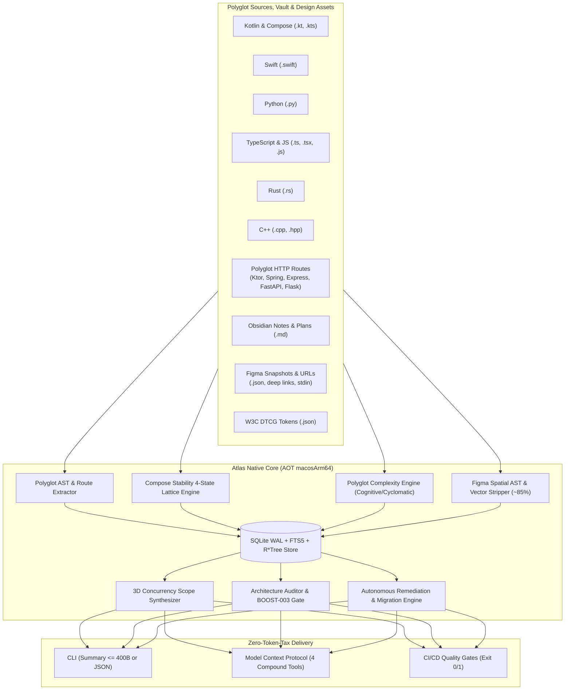

<div align="center">

# Atlas (`code-atlas`)

**Sovereign Polyglot AST, 3D Concurrency Scope & Code Graph Engine**

*Sub-15ms Cold-Start &middot; Ahead-Of-Time Native Binary &middot; Zero Runtime Dependencies &middot; Model Context Protocol (MCP)*

[](https://github.com/jefferyforbes/code-atlas/releases)
[](CHANGELOG.md)
[](https://kotlinlang.org/docs/native-overview.html)
[-000000?logo=apple&logoColor=white)](https://apple.com)
[](https://github.com/jefferyforbes/code-atlas)
[](https://modelcontextprotocol.io)
[](LICENSE)

</div>

---

## The Problem: The Agent "Token Tax"

Autonomous AI coding agents and engineering swarms waste up to **80% of their context windows** repeatedly reading raw source trees, grepping unstructured strings, and speculating about downstream blast radius. Basic questions carry enormous latency and cost:
- *"What calls this function or instantiates this component?"*
- *"If I change this interface or design token, what breaks across modules?"*
- *"Is this Jetpack Compose composable skippable, or will it cause cascading recomposition loops?"*
- *"Does this PR violate Clean Architecture layer boundaries or the Single Declaration Principle?"*
- *"Where must I draw 3D Concurrency Boundaries so parallel subagents don't collide?"*

**Atlas eliminates this token tax.** It parses polyglot code, design tokens, and Figma documents into an embedded SQLite knowledge graph, delivering deterministic answers in **compact, single-line summaries ($\le 400$ bytes)** or structured JSON in **sub-15ms**.

Compiled ahead-of-time (AOT) to a standalone ~3.0 MB native binary (`macosArm64`), Atlas links directly against system `libsqlite3` (`WAL` + `FTS5` + `R*Tree` + `WITHOUT ROWID`), eliminating Python virtualenv friction and JVM cold-start latency.

---

## Performance Benchmarks

Measured on Apple Silicon M-Series (macOS 15 Sequoia):

| Metric | **Atlas Native** (`macosArm64`) | Python (`better-sqlite3`/`ast`) | JVM / Java (`gradle`) |
| :--- | :--- | :--- | :--- |
| **CLI Cold Start** | **~3 ms** (`0.003s`) | ~140–180 ms | ~1,200–2,500 ms |
| **Memory Footprint** | **~6 MB RSS** | ~45–60 MB RSS | ~250–400 MB RSS |
| **Code Index (812 files, 15k edges)** | **~5.2 seconds** | ~18.5 seconds | ~14.0 seconds |
| **Incremental Re-Index (Cache Hit)** | **~0.2 seconds** | ~1.4 seconds | ~3.8 seconds |
| **Compose Stability Extraction (50 files)** | **~18 ms** | ~240 ms | ~900 ms |
| **Compose 12-Rule Gate 1 Audit** | **< 3 ms** | ~35 ms | ~25 ms |
| **Compose Doctor Remediation Preview** | **< 2 ms** | ~20 ms | ~15 ms |
| **Figma Ingestion (10k nodes, DTCG)** | **~0.4 seconds** | ~3.2 seconds | ~2.5 seconds |
| **Figma Vector Bloat Reduction** | **~85% payload cut** | N/A | N/A |
| **2D Spatial R\*Tree Query** | **< 1 ms** | ~12 ms | ~8 ms |
| **12 SQL Design Audits** | **< 5 ms** | ~45 ms | ~25 ms |
| **BFS Shortest Path (16k edges)** | **< 4 ms** | ~35 ms | ~20 ms |
| **Binary Size** | **~3.0 MB** (standalone) | ~40 MB + virtualenv | ~65 MB + JDK |

---

## Quick Start

### Installation

```bash
# 1. Install standalone native binary (Apple Silicon)
mkdir -p ~/.local/bin
curl -sSL https://github.com/jefferyforbes/code-atlas/releases/latest/download/atlas-macos-arm64.tar.gz | tar -xz -C ~/.local/bin/
chmod +x ~/.local/bin/atlas

# 2. Verify installation
atlas --version
```

*Or build from source:*
```bash
git clone https://github.com/jefferyforbes/code-atlas.git && cd code-atlas
./gradlew macosArm64Test
./gradlew installToLocalBin
```

### 30-Second Workflow

```bash
# 1. Index your repository
atlas index --project my-app

# 2. Inspect a symbol, incoming callers, and blast radius (< 5ms)
atlas query --action symbol --target "PaymentService" --include-source
atlas query --action callers --target "PaymentService" --depth 2
atlas query --action impact --target "PaymentService" --depth 2

# 3. Synthesize 3D Concurrency Scope before launching parallel agents
atlas synthesize-scope --project my-app --target "PaymentService"

# 4. Verify architectural integrity & Single Declaration Principle (BOOST-003)
atlas audit --project my-app

# 5. Autonomously remediate violations
atlas fix --project my-app --apply
```

---

## Core Capabilities



### 1. Polyglot AST & Dependency Graph
- **Polyglot Tokenization**: Single-pass AST extraction for Kotlin, Swift, Python, TypeScript/JavaScript, Rust, and C++ with zero LLM overhead.
- **Persistent Unresolved Edges**: Preserves unresolved calls across incremental runs so newly indexed callees automatically link to callers without full workspace re-indexes.
- **Sub-5ms Graph Traversal**: Iterative FIFO Breadth-First Search (BFS) computes directed shortest paths, caller trees, and blast radii across 15,000+ edges in milliseconds.

### 2. URL & Deep-Link Knowledge Graph
- **Polyglot Route Extraction**: Automatically catalogs HTTP endpoints across Spring, Ktor, Express, FastAPI, and Flask into canonical `ENDPOINT` nodes (`endpoint:<METHOD>:<path>`) with producer/consumer edges.
- **Figma Deep Links**: Resolves Figma canvas URLs (`https://www.figma.com/design/.../?node-id=...`) to exact nodes and code design tokens.
- **Code Span Resolution**: Normalizes `file://...#L<line>` and GitHub/GitLab URL fragments to innermost enclosing AST declarations.

### 3. Jetpack Compose Stability & Doctor
- **4-State Join Lattice**: Categorizes `@Composable` parameter stability across `STABLE < RUNTIME < UNCERTAIN < UNSTABLE`.
- **Strong Skipping Reality Check**: Detects `SILENT_WASTE` where Strong Skipping marks composables skippable but unstable instance churn triggers redundant recompositions.
- **12 Deterministic Compose Audits**: Flags mutable state parameters, uncollected flows, raw collections, modifier ordering, and slot lambda conventions.
- **Compose Doctor**: Generates write-site verified (`MUTATES_PROPERTY` safe) code replacements commit-ready via `--apply`.

### 4. Figma Spatial AST & Design Audits
- **Vector Bloat Stripping**: Strips ~85% of raw SVG bezier payloads during ingestion, keeping layout geometry and token bindings ultra-lean.
- **2D R\*Tree Spatial Queries**: Evaluates canvas coordinates and bounding boxes (`--bounds x1,x2,y1,y2`) in $<1$ ms.
- **12 SQL Design Invariants**: Deterministically audits AutoLayout circular sizing (`FILL` in `HUG`), static containers, accessibility touch targets ($\ge 48\times 48\,\text{dp}$), negative coordinates, zero emojis, and WCAG AA contrast.

### 5. Polyglot Complexity Engine
- Computes cyclomatic complexity, cognitive complexity, maximum nesting depth, and function length across 7 languages.
- Enforces Gate 1 complexity thresholds (`atlas audit --complexity`) and prescribes refactoring steps (`atlas doctor --complexity`).

### 6. Autonomous Remediation & Tool Migration
- **`BOOST-003` Single Declaration Engine**: Autonomously splits multi-declaration files into dedicated files preserving package headers, imports, annotations, and KDoc.
- **Privatization (`--make-private`)**: Converts unreferenced secondary declarations to private.
- **Tool Migration Engine (`atlas migrate-tools`)**: Recursively scans and migrates legacy `codegraph_*` calls to `atlas_*` across code, plans, and prompts.

---

## CLI Command Matrix

### Core Code Commands

| Command | Arguments / Flags | Description |
| :--- | :--- | :--- |
| `atlas index` | `[--project <p>] [--paths <p1>...] [--force] [--json]` | Incremental AST and documentation indexer. |
| `atlas query` | `--action <action> [--target <sym>] [--depth <n>]` | Query symbols, callers, callees, impact, god nodes, or shortest path. |
| `atlas query --url` | `--url <url> [--project <p>]` | Resolve HTTP routes, Figma deep links, or code line spans. |
| `atlas synthesize-scope` | `[--project <p>] --paths <f1>...` or `--target <sym>` | Synthesizes 3D Concurrency Boundary (`files`, `modules`, `architecture`). |
| `atlas audit` | `[--project <p>] [--paths <p1>...] [--descriptions <m>]` | Enforce Clean Architecture layers and BOOST-003. Exits 0/1. |
| `atlas fix` | `[--project <p>] [--apply] [--make-private] [--test-cmd <cmd>]` | Autonomously plans, verifies, and applies AST splitting diffs. |
| `atlas dead-code` | `[--project <p>]` | Detect unreferenced top-level declarations with zero callers. |
| `atlas migrate-tools` | `[--path <dir>] [--apply] [--json]` | Detects and migrates deprecated `codegraph_*` tool calls to `atlas_*`. |

### Jetpack Compose Commands (`atlas compose`)

| Command | Arguments / Flags | Description |
| :--- | :--- | :--- |
| `atlas compose index` | `[--project <p>] [--stability-config <cfg>]` | Index composables, compiler metrics, and `@TraceRecomposition`. |
| `atlas compose query` | `--action summary\|cascade\|blame --target <sym>` | Inspect skippability, recomposition cascades, or unstable type blame. |
| `atlas compose audit` | `[--project <p>] [--no-strong-skipping]` | Run 12-rule Compose Gate 1 audit with Strong Skipping Reality Check. |
| `atlas compose doctor` | `[--project <p>] [--target <sym>] [--apply]` | Preview or apply write-site safe Compose stability fixes. |
| `atlas compose synthesize-scope` | `--target <sym>` | Synthesize Compose 3D scope (composables, models, locals). |

### Figma Design Commands (`atlas figma`)

| Command | Arguments / Flags | Description |
| :--- | :--- | :--- |
| `atlas figma index` | `--file <key> --snapshot <path> [--tokens <path>]` | Ingest Figma document snapshot and W3C DTCG design tokens. |
| `atlas figma query` | `--file <key> --action symbol\|callers\|impact\|spatial` | Query components, token usage, or spatial bounding boxes. |
| `atlas figma audit` | `--file <key> [--project <p>]` | Execute 12 deterministic SQL design audits (touch targets, tokens, a11y). |
| `atlas figma synthesize-scope` | `--file <key> --seeds <s1>...` | Synthesize spatial bounds, component sets, and token scopes. |

### Code Complexity Commands (`atlas complexity` or flags)

| Command | Arguments / Flags | Description |
| :--- | :--- | :--- |
| `atlas query --action complexity`| `[--target <sym>] [--threshold <n>] [--limit <n>]` | Inspect function complexity metrics ranked by cognitive load. |
| `atlas audit --complexity` | `[--threshold <n>] [--max-cyclomatic <n>]` | Gate 1 complexity audit enforcing max cognitive/cyclomatic limits. |
| `atlas doctor --complexity` | `[--target <sym>] [--apply] [--test-cmd <cmd>]` | Synthesize refactoring prescriptions for nested decision hot-spots. |

---

## Model Context Protocol (MCP) Integration

Atlas exposes a standard **JSON-RPC 2.0 stdio MCP server** with **4 compound tools**, conforming to the $\le 15$ tools ceiling, $\le 25$-word parameter descriptions, automatic project workspace cache resolution, and 32 KB disk spillover safeguards.

### Tool Catalog

1. **`atlas_query`**: Query polyglot symbols, callers, callees, blast radius, URLs, complexity, and Compose stability.
2. **`atlas_audit`**: Architecture verification, BOOST-003 audits, Compose compliance, complexity gates, 3D scope synthesis, and tool migrations (`migrate_tools`).
3. **`figma_audit`**: Run 12 deterministic design invariant SQL audits over Figma snapshots.
4. **`figma_scope`**: Synthesize 2D spatial canvas bounds and token scopes.

### Client Configuration

Add Atlas to your MCP client configuration (`claude_desktop_config.json`, `.air/mcp.json`, or Antigravity):

```json
{
  "mcpServers": {
    "atlas": {
      "command": "/Users/jefferyforbes/.local/bin/atlas",
      "args": ["serve-mcp", "--workspace", "."]
    }
  }
}
```

### 32 KB Disk Spillover Guardrail
When MCP response payloads exceed **32,768 bytes** (32 KB), Atlas automatically spills the full JSON payload to disk (`~/Library/Caches/atlas/<repo_hash>/artifacts/` or `.atlas/artifacts/`) and returns a lightweight envelope with top central nodes and summary metrics, protecting LLM context windows from truncation.

---

<details>
<summary><strong>Deterministic Audit Invariant Catalogs (Click to expand)</strong></summary>

### 12 Deterministic Compose Invariants

| Rule ID | Category | Severity | Description |
| :--- | :--- | :--- | :--- |
| `UNSTABLE_PARAM` | Stability | `ERROR` | Non-skippable composable due to unstable parameter without `@Stable`/`@Immutable`. |
| `FORCE_INFER_SKIPPABLE` | Stability | `INFO` | Concrete class that can be inferred stable; suggests explicit annotation. |
| `COLLECTION_PARAM_UNSTABLE` | Stability | `WARNING` | Standard collection (`List`, `Set`, `Map`) without `ImmutableList` or `@Immutable`. |
| `MUTABLE_STATE_PARAM` | State Hygiene | `ERROR` | Parameter typed as `MutableState<T>`; state must be hoisted as value + action lambda. |
| `STATE_DECL_NOT_REMEMBERED` | State Hygiene | `ERROR` | `mutableStateOf` instantiated directly in composable body without `remember`. |
| `FLOW_NOT_COLLECTED_AS_STATE` | State Hygiene | `WARNING` | `StateFlow`/`Flow` in body without `collectAsStateWithLifecycle()`. |
| `MODIFIER_NOT_FIRST_DEFAULT` | API Design | `WARNING` | `Modifier` is not first optional parameter or lacks `= Modifier` default. |
| `LAMBDA_TRAILING_SLOT` | API Design | `INFO` | Multi-lambda composable does not place trailing slot lambda last. |
| `HEAVY_ALLOCATION_IN_RECOMPOSITION`| Performance | `WARNING` | Complex computation or regex executed in body without `remember`. |
| `REPEATED_DERIVED_STATE` | Performance | `INFO` | Dependent state recalculated on every recomposition without `derivedStateOf`. |
| `HARDCODED_UI_STRING` | i18n | `WARNING` | Raw string literals in UI body instead of `stringResource(...)`. |
| `LAYER_INVERSION_COMPOSE` | Architecture | `ERROR` | Presentation composable directly imports database DAO or repository. |

### 12 Deterministic Figma Design Invariants

| Rule ID | Category | Description |
| :--- | :--- | :--- |
| `CIRCULAR_V_FILL_IN_HUG` | AutoLayout | Vertical `FILL` child inside `HUG` parent (causes infinite layout loops). |
| `CIRCULAR_H_FILL_IN_HUG` | AutoLayout | Horizontal `FILL` child inside `HUG` parent. |
| `STATIC_CONTAINER_FRAME` | Component | Interactive container has `layoutMode == NONE` instead of AutoLayout. |
| `DEFAULT_100PX_FRAME_HEIGHT` | Layout | Frame stuck at default 100px fixed height; must use `HUG` or optical alignment. |
| `MIN_TOUCH_TARGET` | Accessibility | Interactive hitbox $< 48\times 48\,\text{dp}$ without AutoLayout touch target frame. |
| `NEGATIVE_COORDINATES` | Coordinate | Elements with negative local offsets causing clipping and phantom layout boxes. |
| `CHILD_AMPUTATION_WIDTH` | Sizing | Child inside padded frame has fixed width $\ge$ parent width, truncating content. |
| `NO_EMOJI` | Iconography | Unicode emojis in layer names or text content instead of vector icons. |
| `UNBOUND_TOKENS` | Tokens | Unbound raw hex fills or strokes exceed 5% of total document nodes. |
| `AD_HOC_DETACHED_SPECIMEN` | Gym | Detached static frames in Generative Gym bays instead of live `INSTANCE` nodes. |
| `CANVAS_SPATIAL_TOPOLOGY` | Canvas | Top-level canvas sections violating the 2D orthogonal matrix grid topology. |
| `WCAG_CONTRAST` | WCAG | Text nodes with color contrast ratio $< 4.5:1$ against immediate background. |

</details>

---

## Architecture & Codebase Invariants

Atlas enforces the **Single Declaration Principle (`BOOST-003`)**: every source file contains at most **one** public top-level class, interface, object, or function, matching its file name.

```text
src/macosArm64Main/kotlin/atlas/
├── Main.kt                            # Native CLI process entry point
├── bridge/VaultPlanBridge.kt          # Obsidian [[Wikilinks]], code spans & plans/ extraction
├── cli/CodeGraphCli.kt                # Argument parsing, routing, <=400B compact summaries
├── config/CacheProfileResolver.kt     # Enterprise user cache vs in-repo .atlas/ resolution
├── db/                                # Native SQLite WAL, FTS5, R*Tree & statement wrappers
│   ├── NativeSqliteDatabase.kt
│   ├── NativeSqliteStatement.kt
│   └── SqliteGraphStore.kt
├── engine/                            # Domain engines (BOOST-003 compliant)
│   ├── ArchitectureAuditor.kt         # Clean Architecture layers, BOOST-003 & dead code
│   ├── ArchitectureRemediationEngine.kt # AST file-splitting & privatization
│   ├── AutonomousRemediationVerifier.kt # AST verification & test command rollback guards
│   ├── ComplexityDoctorEngine.kt      # Gate 1 complexity audits & refactoring
│   ├── ComposeStabilityEngine.kt      # 12-rule Compose Gate 1 scoring & Reality Check
│   ├── FigmaDesignAuditor.kt          # 12 deterministic SQL design audits
│   ├── ScopeSynthesizer.kt            # 3D Concurrency Scope synthesizer
│   ├── ToolMigrationEngine.kt         # Deprecated tool scanner and AST migrator
│   ├── WorkMemoryStore.kt             # 30-day exponential decay work memory
│   └── WorkspaceIndexer.kt            # Incremental indexer with raw edge persistence
├── extract/                           # Language & asset tokenizers
│   ├── ComplexityExtractor.kt         # Polyglot cyclomatic, cognitive, nesting & LOC
│   ├── ComposeStabilityExtractor.kt   # Kotlin Compose AST & 4-state stability lattice
│   ├── FigmaSnapshotExtractor.kt      # Figma AST streaming parser & ~85% vector stripper
│   ├── ModuleBoundaryDetector.kt      # Gradle type-safe accessors & KMP expect/actual
│   ├── NameSegmentTokenizer.kt        # Identifier segmentation
│   ├── PolyglotAstExtractor.kt        # Polyglot AST & HTTP route detection
│   ├── SemioticLayerClassifier.kt     # FOROALFA semiotic & architectural classifier
│   └── UrlTargetResolver.kt           # Figma deep links, code spans & route normalizer
├── mcp/CodeGraphMcpServer.kt          # 4-tool Stdio JSON-RPC 2.0 MCP server with 32KB spillover
├── model/                             # Domain data models (BOOST-003 compliant)
└── util/                              # Filesystem utilities & pure Kotlin SHA-256
```

---

## Testing

Atlas is backed by an automated native test suite executing 210+ assertions across parsers, spatial geometry, SQLite transactions, cyclic BFS path finding, Compose stability lattices, and MCP server communication:

```bash
# Run all native unit and integration tests
./gradlew macosArm64Test
```

---

## Releases & Changelog

Atlas follows [Semantic Versioning](https://semver.org/). See [CHANGELOG.md](CHANGELOG.md) for full release notes, migration guides, and historical version comparisons.

---

## License

MIT &copy; 2026 [Jeffery Forbes](https://github.com/jefferyforbes)
