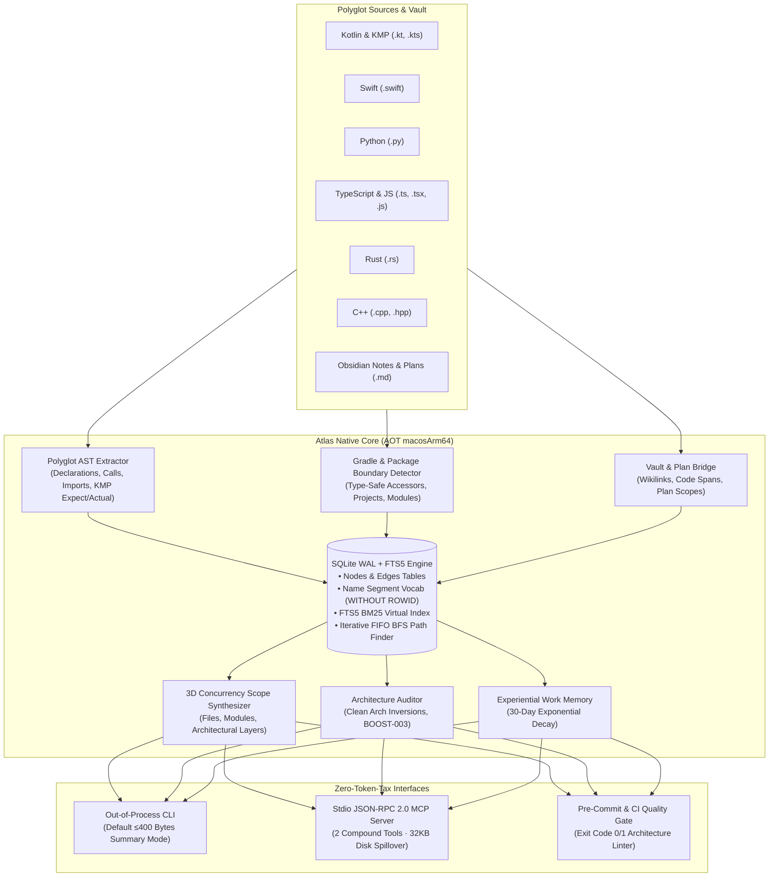

<div align="center">

# Atlas (`code-atlas`)

**Sovereign Polyglot AST, 3D Concurrency Scope & Code Graph Engine**

*Sub-15ms Cold-Start &middot; Ahead-Of-Time Native Binary &middot; Zero Runtime Dependencies &middot; Model Context Protocol (MCP)*

[](https://kotlinlang.org/docs/native-overview.html)
[-000000?logo=apple&logoColor=white)](https://apple.com)
[](https://github.com/jefferyforbes/code-atlas)
[](https://modelcontextprotocol.io)
[](LICENSE)

</div>

---

## Overview

AI coding agents waste thousands of prompt tokens repeatedly reading, parsing, and grepping raw source trees to answer basic questions like:
- *"What calls this function?"*
- *"If I change this interface, what breaks across the codebase?"*
- *"Does this task violate our Clean Architecture layers?"*
- *"What files and modules must be bounded so multiple agents don't step on each other?"*

**Atlas** solves this by providing a **sub-15ms polyglot AST knowledge graph engine** in a single standalone 2.5 MB binary. Compiled ahead-of-time (AOT) via Kotlin/Native (`macosArm64`), Atlas links directly against system `libsqlite3` (`WAL` + `FTS5`), bypassing the Python virtualenv tax and JVM cold-start latency.

Whether invoked directly from your shell, embedded into git pre-commit hooks, or running as a background **Model Context Protocol (MCP)** server, Atlas provides deterministic codebase truth with minimal token consumption.

---

## Architectural Philosophy & Capabilities



### Key Pillars

1. **Polyglot AST Extraction**: Native AST tokenization for Kotlin (including `@Composable`, KMP `expect`/`actual` pairs), Swift, Python, TypeScript/JavaScript, Rust, and C++ with 0 LLM token cost.
2. **Sub-5ms Graph Traversal**: Iterative FIFO Breadth-First Search (BFS) computes directed shortest paths, caller trees, callee cones, and blast radii across 15,000+ edges in milliseconds.
3. **3D Concurrency Scope Synthesis**: Synthesizes exact 3D boundaries (`files`, `modules`, `architecture`) for AI agent orchestration (`/architect`, `/plan`, `/teamwork`), preventing collisions between concurrent task branches.
4. **Clean Architecture & `BOOST-003` Auditor**: Enforces Clean Architecture layer boundaries (flagging illegal Domain $\to$ UI or Domain $\to$ concrete Data references) and the Single Declaration Principle (Rule 6: at most 1 top-level declaration per production file).
5. **Experiential Work Memory**: Attaches agent debugging outcomes (`useful`, `dead_end`, `corrected`) to graph nodes, weighted by an automated 30-day exponential decay half-life.
6. **Dual-Profile Enterprise Cache**: Stores the SQLite database in `~/Library/Caches/atlas/<repo_hash>/atlas.db` by default, keeping your git repository working tree 100% clean.
7. **Strict Token Economy**: CLI queries default to single-line summaries ($\le 400$ bytes) to preserve agent context windows. Large query results exceeding 32 KB automatically spill to disk artifacts with lightweight URI references.

---

## Performance Benchmarks

Measured on Apple Silicon M-Series (macOS 15 Sequoia):

| Metric | **Atlas Native** (`macosArm64`) | Python (`better-sqlite3`/`ast`) | JVM / Java (`gradle`) |
| :--- | :--- | :--- | :--- |
| **CLI Cold Start** | **~3 ms** (`0.003s`) | ~140–180 ms | ~1,200–2,500 ms |
| **Memory Footprint** | **~6 MB RSS** | ~45–60 MB RSS | ~250–400 MB RSS |
| **Initial Index (812 files, 15k edges)** | **~5.2 seconds** | ~18.5 seconds | ~14.0 seconds |
| **Incremental Re-Index (Cache Hit)** | **~0.2 seconds** | ~1.4 seconds | ~3.8 seconds |
| **BFS Shortest Path (16k edges)** | **< 4 ms** | ~35 ms | ~20 ms |
| **Binary Size** | **2.5 MB** (standalone) | ~40 MB + virtualenv | ~65 MB + JDK |

---

## Installation

### Option 1: Quick Install (Recommended)

Download and install the native binary directly to your `~/.local/bin`:

```bash
mkdir -p ~/.local/bin
curl -sSL https://github.com/jefferyforbes/code-atlas/releases/latest/download/atlas-macos-arm64.tar.gz | tar -xz -C ~/.local/bin/
chmod +x ~/.local/bin/atlas

# Verify installation
atlas --help
```

### Option 2: Build From Source

Requirements: macOS (Apple Silicon), JDK 21 (Zulu LTS recommended).

```bash
git clone https://github.com/jefferyforbes/code-atlas.git
cd code-atlas

# Run native test suite
./gradlew macosArm64Test

# Build release binary and install to ~/.local/bin
./gradlew installToLocalBin
```

---

## CLI Reference

### 1. `atlas index`
Incrementally scan and index repository source files and markdown contracts.

```bash
# Index current repository into user cache
atlas index --project my-project

# Index specific subdirectories
atlas index --project my-project --paths shared/ feature/cart/

# Emit full JSON metrics
atlas index --project my-project --json
```

### 2. `atlas query`
Query symbols, call hierarchies, blast radii, or graph topologies.

```bash
# General symbol search
atlas query --action search --target "CartViewModel"

# Inspect symbol declaration coordinates and live source slice
atlas query --action symbol --target "ProductCard" --include-source

# Find incoming callers (who calls this?)
atlas query --action callers --target "formatPrice" --depth 2

# Find outgoing callees (what does this invoke?)
atlas query --action callees --target "CheckoutUseCase" --depth 2

# Compute blast radius impact cone
atlas query --action impact --target "OrderRepository" --depth 2

# Identify high-centrality architectural bottlenecks (God nodes)
atlas query --action god_nodes

# Compute shortest dependency path between decoupled components
atlas query --action shortest_path --target "CartScreen" --secondary-target "PaymentClient"

# Graph summary statistics
atlas query --action status
```

### 3. `atlas synthesize-scope`
Generate empirical 3D Concurrency Boundaries (`files`, `modules`, `architecture`) for task planning.

```bash
atlas synthesize-scope --project my-project --target "CartScreen"
```

*Output (bounded $\le 400$ bytes):*
```text
[3D Scope] project=my-project seeds=[CartScreen] files=18 modules=[:feature:cart, :shared:domain] arch=[pragmatic:presentation, semantic:domain] collisions=[]
```

### 4. `atlas audit`
Enforce Clean Architecture boundaries and the Single Declaration Principle.

```bash
atlas audit --project my-project
```

*Output:*
```text
[Audit] project=my-project passed=true boost003_violations=0 layer_inversions=0 plan_3d_collisions=0
```

---

## Model Context Protocol (MCP) Integration

Atlas exposes a standard **JSON-RPC 2.0 stdio MCP server** with 2 compound tools (`codegraph_query`, `codegraph_audit`) conforming strictly to the $\le 15$ tools ceiling, $\le 25$-word parameter descriptions, and 32 KB disk spillover safeguards.

### Claude Desktop Configuration
Add to `~/Library/Application Support/Claude/claude_desktop_config.json`:

```json
{
  "mcpServers": {
    "atlas": {
      "command": "/Users/jefferyforbes/.local/bin/atlas",
      "args": ["serve-mcp", "--workspace", "/path/to/your/project"]
    }
  }
}
```

### JetBrains Air / Antigravity Configuration
Add to `.air/mcp.json` or Antigravity MCP settings:

```json
{
  "mcpServers": {
    "atlas": {
      "command": "/Users/jefferyforbes/.local/bin/atlas",
      "args": ["serve-mcp", "--workspace", "."]
    }
  }
}
```

---

## Project Structure & Architecture Rules

This repository enforces the **Single Declaration Principle (`BOOST-003`)**: every source file contains strictly **one** top-level class, object, or function matching its filename, with clean imports.

```text
src/macosArm64Main/kotlin/atlas/
├── Main.kt                            # Native CLI process entry point
├── bridge/
│   └── VaultPlanBridge.kt             # Obsidian [[Wikilinks]] & plans/ markdown extraction
├── cli/
│   └── CodeGraphCli.kt                # Argument parsing & summary truncation (≤400 bytes)
├── config/
│   └── CacheProfileResolver.kt        # Enterprise user cache vs in-repo .atlas/ resolution
├── db/
│   ├── NativeSqliteDatabase.kt        # C-interop SQLite3 connection wrapper
│   ├── NativeSqliteStatement.kt       # Compiled prepared statement wrapper
│   └── SqliteGraphStore.kt            # Schema, FTS5 BM25, and iterative FIFO BFS
├── engine/
│   ├── ArchitectureAuditor.kt         # Clean Architecture & BOOST-003 audit rules
│   ├── ScopeSynthesizer.kt            # 3D Concurrency Scope synthesizer
│   └── WorkMemoryStore.kt             # 30-day exponential decay work memory
├── extract/
│   ├── ModuleBoundaryDetector.kt      # Gradle type-safe accessors & KMP expect/actual
│   ├── NameSegmentTokenizer.kt        # CamelCase & snake_case identifier tokenizer
│   ├── PolyglotAstExtractor.kt        # Kotlin, Swift, Python, TS, Rust, C++ extractors
│   └── SemioticLayerClassifier.kt     # FOROALFA semiotic & architectural layer classifier
├── mcp/
│   └── CodeGraphMcpServer.kt          # Stdio JSON-RPC 2.0 MCP server with 32KB spillover
├── model/                             # Data models (GraphNode, GraphEdge, AuditReport, etc.)
└── util/
    ├── PlatformFiles.kt               # Pure POSIX filesystem utilities
    └── Sha256.kt                      # Pure Kotlin FIPS 180-4 SHA-256 implementation
```

---

## Testing

Atlas is covered by a native unit test suite testing cryptographic primitives, tokenizer logic, semiotic classifiers, Gradle module detectors, polyglot extractors, SQLite WAL/FTS5 transactions, cyclic graph BFS pathing, and time-decay math:

```bash
./gradlew macosArm64Test
```

---

## License

MIT &copy; 2026 [Jeffery Forbes](https://github.com/jefferyforbes)
