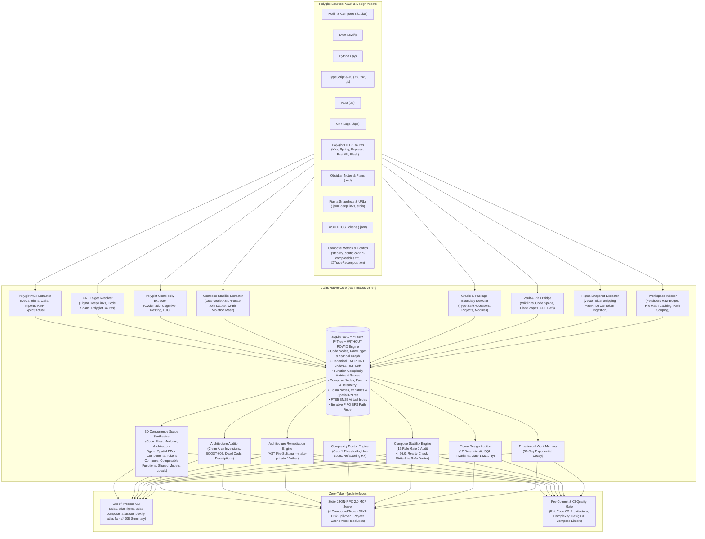

<div align="center">

# Atlas (`code-atlas`)

**Sovereign Polyglot AST, 3D Concurrency Scope & Code Graph Engine**

*Sub-15ms Cold-Start &middot; Ahead-Of-Time Native Binary &middot; Zero Runtime Dependencies &middot; Model Context Protocol (MCP)*

[](https://github.com/jefferyforbes/code-atlas/releases)
[](https://kotlinlang.org/docs/native-overview.html)
[-000000?logo=apple&logoColor=white)](https://apple.com)
[](https://github.com/jefferyforbes/code-atlas)
[](https://modelcontextprotocol.io)
[](LICENSE)

</div>

---

## Overview

AI coding and design agents waste thousands of prompt tokens repeatedly reading, parsing, and grepping raw source trees and heavy design files to answer basic questions like:
- *"What calls this function or instantiates this component?"*
- *"If I change this interface or design token, what breaks downstream?"*
- *"Is this Jetpack Compose composable restartable and skippable, or will it cause cascading recomposition loops?"*
- *"Does this pull request violate Clean Architecture layers, complexity limits, or design system invariants?"*
- *"What files, modules, composable scopes, or canvas regions must be bounded so multiple agents do not collide?"*
- *"What backend endpoint or Figma design does this URL or code reference link to?"*

**Atlas** solves this by providing a **sub-15ms polyglot AST, Jetpack Compose stability, complexity metrics, and design knowledge graph engine** in a single standalone ~3.0 MB binary. Compiled ahead-of-time (AOT) via Kotlin/Native (`macosArm64`), Atlas links directly against system `libsqlite3` (`WAL` + `FTS5` + `R*Tree` + `WITHOUT ROWID`), bypassing the Python virtualenv tax and JVM cold-start latency.

- **v0.3.0 &middot; Figma Atlas (`atlas figma`)**: Indexes Figma document trees and W3C Design Tokens (DTCG), queries 2D spatial layouts via R*Tree bounding boxes, runs 12 deterministic SQL design audits, and synthesizes 3D Concurrency Scopes for design agents.
- **v0.4.0 &middot; Jetpack Compose & KMP Stability (`atlas compose`)**: Analyzes Kotlin `@Composable` functions via single-pass AST tokenization, infers parameter stability across a 4-state join-semilattice (`STABLE < RUNTIME < UNCERTAIN < UNSTABLE`), evaluates 12 deterministic Compose rules, performs the Kotlin 2.0+ Strong Skipping Reality Check (`SILENT_WASTE` detection), runs write-site verified Compose Doctor remediation previews, detects unreferenced dead code (`atlas dead-code`), and enables path-scoped architecture auditing (`--paths`).
- **v0.5.0 &middot; URL Knowledge Graph, Polyglot Complexity Engine & Autonomous Remediation**:
  - **URL & Figma Deep-Link Knowledge Graph (`atlas query --url`)**: Unifies code, documentation, endpoints, and design into an interconnected graph. Automatically extracts polyglot HTTP routes (Spring, Ktor, Express, FastAPI, Flask) into canonical `ENDPOINT` nodes (`endpoint:<METHOD>:<path>`) with producer/consumer edges (`PRODUCES_ENDPOINT`, `CALLS_ENDPOINT`). Resolves Figma canvas deep links (`https://www.figma.com/design/.../?node-id=...`) to Figma nodes and code tokens. Resolves code location links (`file://...#L<line>`, GitHub/GitLab `#L<line>`) to innermost enclosing AST declaration/call spans. Maps Markdown docs and vault plans (`url_ref` edges). Supported via `--url <url>` and MCP `atlas_query` (`action: "url"`).
  - **Polyglot Code Complexity Engine (`atlas complexity`)**: Computes cyclomatic complexity, cognitive complexity, max nesting depth, and function length across Kotlin, Swift, TypeScript/JavaScript, Python, Rust, Go, and C++. Includes Gate 1 complexity audits (`atlas complexity audit`) and actionable doctor remediation prescriptions (`atlas complexity doctor`).
  - **Autonomous Architecture Remediation Engine (`atlas fix`)**: Plans, verifies, and applies automated AST file-splitting diffs for `BOOST-003` Single Declaration Principle compliance, converts unreferenced secondary declarations to private (`--make-private`), corrects layer classification inversions, and verifies test-command rollback guards.
  - **Top-Level Description Audit (`atlas audit --check-descriptions`)**: Extracts docstrings, KDoc, and JSDoc comments for top-level declarations, persisting coverage to SQLite with actionable suggestions.
  - **Autonomous Compose Doctor Remediation (`atlas compose doctor --apply`)**: Automated remediation of Compose stability anti-patterns with write-site safety verification and batched Figma graph traversal.
- **v0.5.1 &middot; Engine Correctness, FTS5 Scalability & Platform Hardening**:
  - **Native SQLite FTS5 Indexing & Deletion Hardening**: Eliminates $O(N^2)$ full-table scans during batch deletion and indexing by indexing `node_id` and `project_id` in `nodes_fts`, with composite indexes on `edges` (`source_node_id`, `target_node_id`, `project_id`) accelerating degree recomputations.
  - **Compose Stability Scope Isolation (`BIT_STAB_002`)**: Isolates broken `@Immutable`/`@Stable` contract violations strictly to composables that reference unstable types, preventing workspace-wide false positive contamination.
  - **Deterministic Compose Doctor (`atlas compose doctor --apply`)**: Synthesizes AST source replacements directly from disk for real-world verified file rewrites.
  - **Polyglot Complexity Accuracy**: Properly counts Rust `match` arms (`=>`), restricts Kotlin `when` arrow branches to switch-like scopes (`parenDepth == 0`), and avoids false positives on lambdas, function types, return types, and C++ pointer dereferences.
  - **Cross-File Edge Resolution & Import Wildcards**: Full support for wildcard imports (`import foo.*`) restoring affinity weighting, coupled with class-qualified method `nodeId`s across Python, Swift, TypeScript, Rust, and C++.
  - **CI/CD & Platform Resilience**: Modernizes GitHub Actions workflow to valid upstream actions, prevents test cache directory leaks, and resolves macOS `/tmp` symlinks consistently.

Whether invoked directly from your shell, embedded into git pre-commit hooks, or running as a background **Model Context Protocol (MCP)** server, Atlas provides deterministic codebase and design truth with minimal token consumption.

---

## Architectural Philosophy & Capabilities



### Key Pillars

1. **Polyglot AST Extraction**: Native AST tokenization for Kotlin (including `@Composable`, KMP `expect`/`actual` pairs), Swift, Python, TypeScript/JavaScript, Rust, and C++ with 0 LLM token cost.
2. **URL & Figma Deep-Link Knowledge Graph (`atlas query --url`)**: Unifies code, documentation, endpoints, and design into an interconnected graph. Automatically extracts polyglot HTTP routes (Spring, Ktor, Express, FastAPI, Flask) into canonical `ENDPOINT` nodes (`endpoint:<METHOD>:<path>`) with producer/consumer edges (`PRODUCES_ENDPOINT`, `CALLS_ENDPOINT`). Resolves Figma canvas deep links (`https://www.figma.com/design/.../?node-id=...`) to Figma nodes and code tokens. Resolves code location links (`file://...#L<line>`, GitHub/GitLab `#L<line>`) to innermost enclosing AST declaration/call spans. Maps Markdown docs and vault plans (`url_ref` edges). Supported via `--url <url>` and MCP `atlas_query` (`action: "url"`).
3. **Polyglot Code Complexity Engine (`atlas complexity`)**: Extracts cyclomatic complexity, cognitive complexity, max nesting depth, and function length across Kotlin, Swift, TypeScript/JavaScript, Python, Rust, Go, and C++. Enforces Gate 1 complexity thresholds (`atlas complexity audit`) and delivers actionable doctor remediation prescriptions (`atlas complexity doctor`).
4. **Jetpack Compose & KMP Stability Engine (`atlas compose`)**: Single-pass comment/string-masked Kotlin AST extractor inferring `@Composable` skippability, parameter stability over a 4-state join-semilattice (`STABLE < RUNTIME < UNCERTAIN < UNSTABLE`), `stability_config.conf` glob matching, Compose Compiler report ingestion, and `@TraceRecomposition` runtime telemetry.
5. **12 Deterministic Compose Invariant Audits**: Evaluates unstable parameters, unremembered state declarations, raw collections, mutable state parameters, uncollected flows, modifier order, slot lambda conventions, heavy recomposition allocations, repeated derived state, hardcoded UI strings, and Compose layer inversions.
6. **Strong Skipping Reality Check & Compose Doctor**: Detects `SILENT_WASTE` where Strong Skipping marks composables skippable but unstable instance churn triggers silent recompositions. Compose Doctor produces prioritized, write-site verified (`MUTATES_PROPERTY` safe) `before`/`after` remediation diffs, executable directly with `--apply`.
7. **Workspace Indexer & Raw Edge Persistence**: Persists raw unresolved symbol edges (`raw_symbol_edges`) across incremental runs so unchanged callers automatically link to newly added callees (`BUG-01`), with in-memory file caching and no-op short-circuiting.
8. **Dead Code Detection & Path-Scoped Audits**: Identifies unreferenced production declarations (`atlas dead-code`) and supports targeted path filtering (`--paths`) in `atlas audit` and MCP tools for fast PR-scoped verification.
9. **Sub-5ms Graph Traversal**: Iterative FIFO Breadth-First Search (BFS) computes directed shortest paths, caller trees, callee cones, and blast radii across 15,000+ edges in milliseconds.
10. **3D Concurrency Scope Synthesis**: Synthesizes exact 3D boundaries (`files`, `modules`, `architecture`, `composable_functions`, `shared_state_models`, `composition_locals`) for multi-agent orchestration (`/architect`, `/plan`, `/teamwork`), preventing merge collisions.
11. **Figma Spatial AST & 2D R\*Tree Indexing**: Parses Figma document node trees, stores geometric bounds into an SQLite `rtree` virtual table, and executes spatial overlap / containment queries (`--bounds x1,x2,y1,y2`) in $<1$ ms.
12. **Vector Bloat Stripping & W3C DTCG Token Ingestion**: Strips heavy SVG vector path and bezier payloads (~85% reduction) during ingestion, imports DTCG design token bundles, and resolves alias DAGs with cycle detection.
13. **12 Deterministic SQL Design Invariant Audits**: Evaluates AutoLayout geometry, static containers, default 100px frame heights, accessibility touch targets ($\ge 48\times 48\,\text{dp}$), negative coordinates, child width amputation, zero emojis, unbound token ratios, detached gym specimens, 2D canvas topology, and WCAG AA contrast ratios.
14. **Clean Architecture & `BOOST-003` Auditor**: Enforces Clean Architecture layer boundaries (flagging illegal Domain $\to$ UI or Domain $\to$ concrete Data references) and the Single Declaration Principle (Rule 6: at most 1 top-level declaration per production file).
15. **Autonomous Architecture Remediation Engine (`atlas fix`)**: Synthesizes verified AST file-splitting diffs for `BOOST-003` Single Declaration Principle violations (extracting secondary declarations into dedicated files with preserved package headers, imports, annotations, and KDoc), converts unreferenced secondary declarations to private (`--make-private`), corrects layer classification inversions, and automatically re-indexes modified files with rollback protection on test suite failures.
16. **Top-Level Description Audit (`atlas audit --check-descriptions`)**: Extracts docstrings, KDoc, and JSDoc comments for top-level declarations, persisting coverage to SQLite with actionable suggestions.

---

## Performance Benchmarks

Measured on Apple Silicon M-Series (macOS 15 Sequoia):

| Metric | **Atlas Native** (`macosArm64`) | Python (`better-sqlite3`/`ast`) | JVM / Java (`gradle`) |
| :--- | :--- | :--- | :--- |
| **CLI Cold Start** | **~3 ms** (`0.003s`) | ~140–180 ms | ~1,200–2,500 ms |
| **Memory Footprint** | **~6 MB RSS** | ~45–60 MB RSS | ~250–400 MB RSS |
| **Code Index (812 files, 15k edges)** | **~5.2 seconds** | ~18.5 seconds | ~14.0 seconds |
| **Incremental Re-Index (Cache Hit)** | **~0.2 seconds** | ~1.4 seconds | ~3.8 seconds |
| **Compose Stability Extraction (50 files)** | **~18 ms** | ~240 ms | ~900 ms |
| **Compose 12-Rule Gate 1 Audit** | **< 3 ms** | ~35 ms | ~25 ms |
| **Compose Doctor Remediation Preview** | **< 2 ms** | ~20 ms | ~15 ms |
| **Figma Ingestion (10k nodes, DTCG)** | **~0.4 seconds** | ~3.2 seconds | ~2.5 seconds |
| **Figma Vector Bloat Reduction** | **~85% payload cut** | N/A | N/A |
| **2D Spatial R\*Tree Query** | **< 1 ms** | ~12 ms | ~8 ms |
| **12 SQL Design Audits** | **< 5 ms** | ~45 ms | ~25 ms |
| **BFS Shortest Path (16k edges)** | **< 4 ms** | ~35 ms | ~20 ms |
| **Binary Size** | **~3.0 MB** (standalone) | ~40 MB + virtualenv | ~65 MB + JDK |

---

## Installation

### Option 1: Quick Install (Recommended)

Download and install the native binary directly to your `~/.local/bin`:

```bash
mkdir -p ~/.local/bin
curl -sSL https://github.com/jefferyforbes/code-atlas/releases/latest/download/atlas-macos-arm64.tar.gz | tar -xz -C ~/.local/bin/
chmod +x ~/.local/bin/atlas

# Verify installation
atlas --version
atlas --help
```

### Option 2: Build From Source

Requirements: macOS (Apple Silicon), JDK 21 (Zulu LTS recommended).

```bash
git clone https://github.com/jefferyforbes/code-atlas.git
cd code-atlas

# Run native test suite
./gradlew macosArm64Test

# Build release binary and install to ~/.local/bin
./gradlew installToLocalBin

# Verify installation
atlas --version
atlas compose --help
atlas figma --help
```

---

## CLI Reference

### Global Options

```text
  --version, -v            Print version information (supports --json)
  --help, -h               Print help information
  --project <name>         Target project slug (default: organisation)
  --workspace <dir>        Workspace root directory (default: .)
  --db <path>              Custom SQLite database path
  --cache-profile <p>      'enterprise' (user cache) or 'in-repo' (.atlas/)
  --json                   Emit full formatted JSON output
  --summary                Emit compact summary <= 400 bytes (default)
  --url <url>              Query nodes, endpoints, or spans matching a URL / deep link
  --threshold <n>          Cognitive complexity threshold for filtering or audit (default: 10)
  --max-cognitive <n>      Alias for --threshold
  --max-cyclomatic <n>     Cyclomatic complexity threshold
  --descriptions <mode>    Doc description audit mode ('domain-only', 'all', 'off')
```

---

### Code Commands

#### 1. `atlas index`
Incrementally scan and index repository source files, markdown contracts, and Compose stability metadata. Re-resolves persisted raw symbol edges so callers link to newly added declarations.

```bash
# Index current repository into user cache
atlas index --project my-project

# Index specific subdirectories or PR scopes
atlas index --project my-project --paths shared/ feature/cart/

# Force re-index bypassing file-hash caching
atlas index --project my-project --force

# Emit full JSON metrics
atlas index --project my-project --json
```

#### 2. `atlas query`
Query symbols, call hierarchies, blast radii, URLs, or graph topologies.

```bash
# General symbol search
atlas query --action search --target "CartViewModel"

# Query by URL: Figma canvas deep link, code line location, or HTTP route
atlas query --url "https://www.figma.com/design/LVhI2ueu8A6igT14N8m1MM/App?node-id=42-123"
atlas query --url "file://src/models/Cart.kt#L45"
atlas query --url "GET /api/v1/checkout"
atlas query --url "https://github.com/org/repo/blob/main/src/App.kt#L100"

# Inspect symbol declaration coordinates and live source slice
atlas query --action symbol --target "ProductCard" --include-source

# Find incoming callers (who calls this?)
atlas query --action callers --target "formatPrice" --depth 2

# Find outgoing callees (what does this invoke?)
atlas query --action callees --target "CheckoutUseCase" --depth 2

# Compute blast radius impact cone
atlas query --action impact --target "OrderRepository" --depth 2

# Identify high-centrality architectural bottlenecks (God nodes)
atlas query --action god_nodes

# Compute shortest dependency path between decoupled components
atlas query --action shortest_path --target "CartScreen" --secondary-target "PaymentClient"

# Graph summary statistics
atlas query --action status
```

#### 3. `atlas synthesize-scope`
Generate empirical 3D Concurrency Boundaries (`files`, `modules`, `architecture`) for task planning.

```bash
atlas synthesize-scope --project my-project --target "CartScreen"
```

*Output (bounded $\le 400$ bytes):*
```text
[3D Scope] project=my-project seeds=[CartScreen] files=18 modules=[:feature:cart, :shared:domain] arch=[pragmatic:presentation, semantic:domain] collisions=[]
```

#### 4. `atlas audit`
Enforce Clean Architecture layer boundaries, the Single Declaration Principle (`BOOST-003`), active plan collisions, doc descriptions, and optionally Jetpack Compose stability or complexity. Exits `0` on clean pass and `1` on violations.

```bash
# Full workspace audit
atlas audit --project my-project

# Audit top-level doc descriptions (domain-only, all, off)
atlas audit --project my-project --descriptions domain-only

# Path-scoped audit for targeted PR verification
atlas audit --project my-project --paths src/macosArm64Main/kotlin/atlas/engine/

# Combined architecture and Compose stability audit
atlas audit --project my-project --compose

# Combined architecture and Polyglot Complexity audit
atlas audit --project my-project --complexity --threshold 15
```

*Output:*
```text
[Audit] project=my-project passed=true boost003_violations=0 layer_inversions=0 plan_3d_collisions=0 description_suggestions=0
```

#### 5. `atlas dead-code`
Detect unreferenced top-level functions, classes, and properties with 0 incoming callers across the indexed codebase.

```bash
atlas dead-code --project my-project
```

*Output:*
```text
[Dead Code] project=my-project dead_symbols=3 top=[LegacyPaymentFormatter, oldUnusedHelper, StaleTokenParser]
```

#### 6. `atlas fix`
Autonomously plan, verify, and remediate architecture audit violations (`BOOST-003` Single Declaration Principle and `ARCH-LAYER-INVERSION` Clean Architecture inversions).

```bash
# Preview remediations across the workspace (dry-run, default)
atlas fix --project my-project

# Preview remediations for specific files or paths
atlas fix --project my-project --paths src/models/

# Apply verified AST file-splitting and re-index automatically
atlas fix --project my-project --apply

# Remediate by converting unreferenced secondary declarations to private
atlas fix --project my-project --make-private --apply

# Remediate with test suite preservation guard (rolls back on test failure)
atlas fix --project my-project --apply --test-cmd "./gradlew check"
```

*Output:*
```text
[Remediation] project=my-project mode=dry-run violations=3 boost003=2 layer_inversions=1 verified=3 applied=0
  - BOOST-003: src/models/UserModels.kt [AST_FILE_SPLIT, verified=true, applied=false]
  - ARCH-LAYER-INVERSION: src/domain/PaymentService.kt [CLASSIFICATION_CORRECTION, verified=true, applied=false]
```

*JSON output (`--json`):*
```json
{
  "project": "my-project",
  "total_violations": 3,
  "boost003_count": 2,
  "layer_inversion_count": 1,
  "verified_count": 3,
  "applied_count": 0,
  "dry_run": true,
  "prescriptions": [
    {
      "id": "rx-boost003-UserModels",
      "rule_id": "BOOST-003",
      "file_path": "src/models/UserModels.kt",
      "fix_strategy": "AST_FILE_SPLIT",
      "rationale": "File declares multiple public top-level types (UserModels, UserSettings). Split secondary declaration into dedicated file.",
      "primary_declaration": "UserModels",
      "secondary_declarations": ["UserSettings"],
      "spawned_files": [
        {
          "rel_path": "src/models/UserSettings.kt",
          "declaration_name": "UserSettings",
          "loc": 14
        }
      ],
      "verified": true,
      "applied": false
    }
  ]
}
```

---

### Polyglot Code Complexity Commands (`atlas complexity`)

Atlas provides a native polyglot code complexity engine that extracts and scores **cyclomatic complexity**, **cognitive complexity**, **maximum nesting depth**, and **lines of code (LOC)** per function across Kotlin, Swift, TypeScript/JavaScript, Python, Rust, Go, and C++.

#### 1. `atlas complexity query`
Query functions ranked by cognitive or cyclomatic complexity, or inspect complexity metrics for specific symbols.

```bash
# Query top complex functions across the repository
atlas query --action complexity --project my-project --limit 10

# Filter functions exceeding a specific cognitive complexity threshold
atlas query --action complexity --project my-project --threshold 15

# Query complexity for a specific function or target symbol
atlas query --action complexity --project my-project --target "parsePayload"
```

*Output:*
```text
[Complexity] project=my-project functions=142 top_cognitive=18 avg_cognitive=4.2 over_threshold=3
```

#### 2. `atlas complexity audit`
Enforce Gate 1 code complexity thresholds in pre-commit hooks and CI/CD quality gates. Exits `0` on clean pass and `1` when functions exceed specified limits.

```bash
# Run complexity audit with default cognitive threshold (10)
atlas audit --complexity --project my-project

# Run complexity audit with custom cognitive threshold and cyclomatic limits
atlas audit --complexity --project my-project --threshold 15 --max-cyclomatic 10

# Audit specific paths or PR diff scopes
atlas audit --complexity --project my-project --paths src/macosArm64Main/kotlin/
```

*Output:*
```text
[Complexity Audit] project=my-project passed=true functions=210 over_threshold=0 max_cognitive=9
```

#### 3. `atlas complexity doctor`
Generate actionable refactoring prescriptions, decompose nested decision logic, extract helper functions, and flatten control-flow hot-spots.

```bash
# Preview complexity doctor prescriptions across the project
atlas doctor --complexity --project my-project --limit 5

# Target doctor refactoring analysis on a specific function
atlas doctor --complexity --project my-project --target "handleTransaction"
```

---

### Jetpack Compose Stability Commands (`atlas compose`)

Atlas provides a dedicated native engine for Kotlin & Jetpack Compose stability analysis, compiler report verification, and automated doctor remediation.

#### 1. `atlas compose index`
Extracts Kotlin `@Composable` declarations, infers parameter stability, matches `stability_config.conf` wildcard rules, ingests Compose Compiler reports (`*-composables.txt`), and correlates `@TraceRecomposition` telemetry.

```bash
# Index Compose stability across the workspace
atlas compose index --project android-app

# Index with custom stability config and compiler reports
atlas compose index --project android-app \
  --stability-config app/stability_config.conf \
  --compiler-reports build/compose_metrics/
```

*Output:*
```text
[Atlas Compose] project=android-app composables=142 skippable=128 compiler_upgraded=14 traces=0
```

#### 2. `atlas compose query`
Inspect composable skippability, analyze cascading recomposition cones, or trace root causes of unstable types.

```bash
# General Compose stability summary
atlas compose query --project android-app --target "ProductCard"

# Cascade query: identify downstream composables forced to recompose
atlas compose query --project android-app --action cascade --target "ProductCard" --depth 5

# Blame query: trace upstream caller/type causing non-skippability
atlas compose query --project android-app --action blame --target "CheckoutScreen"
```

*Output:*
```text
[Compose Query: summary] project=android-app composables=1 skippable=0 (0.0%) unstable_params=1 cascade=4 blame=1
```

#### 3. `atlas compose audit`
Run 12 deterministic Compose invariant audits with Gate 1 compliance scoring ($\le 95.0$ ceiling, $\ge 80.0$ passing threshold), Strong Skipping Reality Check, and Remaining 5% Polish Delta. Exits `0` on pass and `1` on failure.

```bash
# Run Compose Gate 1 stability audit
atlas compose audit --project android-app

# Audit with Strong Skipping disabled (Kotlin 1.9 compatibility)
atlas compose audit --project android-app --no-strong-skipping
```

*Output:*
```text
[Compose Audit] project=android-app status=PASS score=91.5/100 (Gate1<=95.0) composables=142 violations=3 strong_skipping=true
```

*JSON output (`--json`):*
```json
{
  "projectId": "android-app",
  "overallScore": 91.5,
  "status": "PASS",
  "totalComposables": 142,
  "skippableCount": 128,
  "skippablePercentage": 90.1,
  "realityCheckSummary": {
    "confirmed": 1,
    "falseAlarm": 2,
    "silentWaste": 0,
    "healthy": 128
  },
  "violations": [
    {
      "ruleId": "COLLECTION_PARAM_UNSTABLE",
      "severity": "WARNING",
      "composableName": "ProductList",
      "message": "Parameter 'items' has unstable collection interface 'List<ProductItem>'",
      "filePath": "src/main/kotlin/ui/ProductList.kt",
      "line": 42
    }
  ],
  "remainingPolishDelta": [
    "Replace standard List<T> with ImmutableList<T> or @Immutable wrapper",
    "Verify modifier parameter ordering on secondary sub-composables",
    "Optical kerning and tabular numeral alignment on dynamic data labels",
    "Micro-interaction spring physics and capacitive press state damping"
  ]
}
```

#### 4. `atlas compose doctor`
Synthesize write-site safe automated remediation previews. Verifies that fields are not mutated (`MUTATES_PROPERTY` check) before recommending `@Immutable`, and outputs exact Kotlin `before`/`after` code snippets.

```bash
# Generate prioritized Compose stability fixes (preview)
atlas compose doctor --project android-app --limit 5

# Target a specific composable
atlas compose doctor --project android-app --target "OrderSummaryCard"

# Apply verified Compose stability fixes directly to disk
atlas compose doctor --project android-app --apply
```

*Output:*
```text
[Compose Doctor] project=android-app mode=ESTIMATED prescriptions=3 top_rule=COLLECTION_PARAM_UNSTABLE
```

#### 5. `atlas compose synthesize-scope`
Synthesizes Compose-aware 3D Concurrency Scopes (`composable_functions`, `shared_stable_models`, `composition_locals`) around seed composables to prevent concurrent coding agents from causing merge collisions on shared UI state models or theme tokens.

```bash
atlas compose synthesize-scope --project android-app --target "CartScreen"
```

*Output:*
```text
[Compose 3D Scope] project=android-app files=6 shared_models=2 locals=1 parallel_safe=true
```

---

## The 12 Deterministic Compose Invariant Audits

Atlas evaluates Jetpack Compose and Compose Multiplatform codebases against 12 deterministic stability and architecture invariants:

| Rule ID | Category | Severity | Description & Enforcement Standard |
| :--- | :--- | :--- | :--- |
| `UNSTABLE_PARAM` | Stability | `ERROR` | Composable is marked restartable but non-skippable due to an unstable parameter type without `@Stable`/`@Immutable` or config match. |
| `FORCE_INFER_SKIPPABLE` | Stability | `INFO` | Parameter is typed with a concrete class that can be inferred stable at runtime; suggests explicit configuration or annotation. |
| `COLLECTION_PARAM_UNSTABLE` | Stability | `WARNING` | Parameter is typed as standard standard Java/Kotlin collection (`List`, `Set`, `Map`) without `ImmutableList` or `@Immutable`. |
| `MUTABLE_STATE_PARAM` | State Hygiene | `ERROR` | Parameter typed directly as `MutableState<T>`; state must be hoisted via value + action lambda (`(T) -> Unit`). |
| `STATE_DECL_NOT_REMEMBERED` | State Hygiene | `ERROR` | `mutableStateOf(...)` or `mutableStateListOf(...)` instantiated directly in composable body without enclosing `remember`. |
| `FLOW_NOT_COLLECTED_AS_STATE` | State Hygiene | `WARNING` | `StateFlow` or `Flow` referenced directly in composable body without `collectAsStateWithLifecycle()` or `collectAsState()`. |
| `MODIFIER_NOT_FIRST_DEFAULT` | API Design | `WARNING` | Composable accepts a `Modifier` that is not the first optional parameter or fails to provide `= Modifier` default. |
| `LAMBDA_TRAILING_SLOT` | API Design | `INFO` | Composable with multiple lambda parameters does not order trailing slot content lambda as the final parameter. |
| `HEAVY_ALLOCATION_IN_RECOMPOSITION`| Performance | `WARNING` | Complex computation, regex compilation, date formatters, or collection filtering executed in body without `remember`. |
| `REPEATED_DERIVED_STATE` | Performance | `INFO` | Dependent state computations recalculated on every recomposition instead of being cached with `derivedStateOf`. |
| `HARDCODED_UI_STRING` | Internationalization | `WARNING` | Raw string literals in UI composable body instead of `stringResource(...)` or `Res.string`. |
| `LAYER_INVERSION_COMPOSE` | Architecture | `ERROR` | Leaf presentation sub-composable directly imports database DAO, network client, or repository instead of hoisted state. |

### Strong Skipping Reality Check

Under Kotlin 2.0+ Strong Skipping mode, Atlas classifies every composable into four empirical behavioral categories:

| Status | Definition & Behavioral Consequence |
| :--- | :--- |
| `CONFIRMED` | **Real Recomposition Hazard**: Unstable parameter instance identity changes on every parent recomposition, triggering child recomposition despite Strong Skipping. |
| `FALSE_ALARM` | **Safe Unstable Parameter**: Parameter type is theoretically unstable, but callers pass stable references or hoisted lambdas; no redundant recomposition occurs. |
| `SILENT_WASTE` | **Invisible Waste**: Strong Skipping marks the composable skippable, but unstable parameter churn continuously triggers silent recompositions with 0 compiler warnings. |
| `HEALTHY` | **Fully Skippable**: Composable contains only stable primitives, `@Immutable` models, or stable lambdas, correctly skipping when inputs are unchanged. |

---

### Figma Commands (`atlas figma`)

Figma Atlas provides sub-millisecond AST and spatial operations over Figma document trees and design tokens.

#### 1. `atlas figma index`
Ingest a Figma JSON snapshot and optional W3C DTCG design token bundle. Raw vector paths are automatically stripped (~85% size reduction) while structural layout, AutoLayout rules, and spatial bounds are preserved.

```bash
# Ingest document snapshot and design tokens
atlas figma index --project relay --file LVhI2ueu8A6igT14N8m1MM \
  --snapshot .artifacts/figma/document.json \
  --tokens .artifacts/figma/tokens.json

# Stream document snapshot directly via stdin
cat snapshot.json | atlas figma index --project relay --file LVhI2ueu8A6igT14N8m1MM --stdin
```

*Output:*
```text
[Atlas Figma] Indexed project=relay fileKey=LVhI2ueu8A6igT14N8m1MM nodes=1420 variables=84 edges=2180
```

#### 2. `atlas figma query`
Query Figma nodes, component instances, variable consumers, and spatial regions.

```bash
# Query node attributes and sizing properties
atlas figma query --project relay --file LVhI2ueu8A6igT14N8m1MM --target "PrimaryButton"

# Find component instances (callers) referencing a master component
atlas figma query --project relay --file LVhI2ueu8A6igT14N8m1MM --action callers --target "PrimaryButton" --depth 2

# Query design token / variable impact cone (which nodes use this color token?)
atlas figma query --project relay --file LVhI2ueu8A6igT14N8m1MM --action impact --target "color/primary"

# 2D Spatial R*Tree bounding box intersection query (min_x, max_x, min_y, max_y)
atlas figma query --project relay --file LVhI2ueu8A6igT14N8m1MM --action spatial --bounds 0,1440,0,900

# High-centrality master components (God nodes with excessive instances)
atlas figma query --project relay --file LVhI2ueu8A6igT14N8m1MM --action god_nodes

# Shortest dependency path between two components
atlas figma query --project relay --file LVhI2ueu8A6igT14N8m1MM --action shortest_path \
  --target "CheckoutSheet" --secondary-target "PaymentIcon"
```

#### 3. `atlas figma audit`
Run 12 deterministic SQL design audits enforcing Figma AutoLayout geometry, accessibility touch targets, token bindings, AA contrast ratios, and naming discipline. Exits `0` on clean pass and `1` on violations.

```bash
atlas figma audit --project relay --file LVhI2ueu8A6igT14N8m1MM
```

*Output:*
```text
[Figma Audit] project=relay file=LVhI2ueu8A6igT14N8m1MM passed=true score=95/100 violations=0 polish_delta=4
```

#### 4. `atlas figma synthesize-scope`
Synthesizes 3D Concurrency Scope (`spatial_bounds`, `component_instances`, `variable_tokens`) around seed nodes to prevent concurrent agents from colliding on canvas regions, component hierarchies, or shared design tokens.

```bash
atlas figma synthesize-scope --project relay --file LVhI2ueu8A6igT14N8m1MM --seeds "TaskCard" "FilterChip"
```

*Output:*
```text
[Figma 3D Scope] project=relay file=LVhI2ueu8A6igT14N8m1MM bounds=[0..400, 120..600] nodes=14 shared_components=2 tokens=6
```

---

## The 12 Deterministic Design Invariant Audits

Atlas evaluates Figma documents against 12 non-negotiable design system invariants:

| Rule ID | Invariant Category | Description & Enforcement Standard |
| :--- | :--- | :--- |
| `CIRCULAR_V_FILL_IN_HUG` | AutoLayout Geometry | Child node has vertical sizing `FILL` inside a parent with vertical sizing `HUG`. Causes infinite circular layout calculations in Figma. |
| `CIRCULAR_H_FILL_IN_HUG` | AutoLayout Geometry | Child node has horizontal sizing `FILL` inside a parent with horizontal sizing `HUG`. |
| `STATIC_CONTAINER_FRAME` | Component Hygiene | Interactive container, component, or component set variant has `layoutMode == NONE` (absolute positioning). Production components must use AutoLayout (`HORIZONTAL` or `VERTICAL`). |
| `DEFAULT_100PX_FRAME_HEIGHT` | Layout Bug Prevention | Frame has default fixed height 100.0px (stuck at unmanaged `figma.createFrame()` default). Inner chips, pills, or rows must use `HUG` sizing or optical vertical centering. |
| `MIN_TOUCH_TARGET` | Accessibility | Interactive control (button, chip, toggle, icon button, checkbox) has hitbox bounds $< 48\times 48\,\text{dp}$ without an enclosing $\ge 48\times 48\,\text{dp}$ AutoLayout touch target container. |
| `NEGATIVE_COORDINATES` | Coordinate Hygiene | Elements inside containers with negative local offsets (`local_x < 0` or `local_y < 0`), causing clipping and phantom 300px+ layout boundaries. |
| `CHILD_AMPUTATION_WIDTH` | AutoLayout Sizing | Child element inside padded AutoLayout container has fixed width $\ge$ parent width, causing visual truncation. Must use `layoutSizingHorizontal = FILL`. |
| `NO_EMOJI` | Professional Iconography | Layers with unicode emojis in node names or text content. Enforces professional iconography (Lucide, Material Symbols, SF Symbols) over unicode emojis. |
| `UNBOUND_TOKENS` | Token Discipline | Flags documents where unbound raw color fills or strokes exceed 5% of total document nodes. Enforces semantic token bindings. |
| `AD_HOC_DETACHED_SPECIMEN` | Generative Gym Discipline | Detached static frames inside Generative Gym arenas instead of live master component instances (`INSTANCE`). |
| `CANVAS_SPATIAL_TOPOLOGY` | Canvas Topology | Top-level canvas sections violating the 2D orthogonal matrix grid (Row 1 User Flows at $y=0$, Design System column at $y=5000, x=0$, Gym Arenas at $y\ge 5000, x\ge 4000$). |
| `WCAG_CONTRAST` | Accessibility (WCAG) | Text nodes with color contrast ratio $< 4.5:1$ against immediate background ($< 3.0:1$ for large text $\ge 24\,\text{px}$). |

---

## Model Context Protocol (MCP) Integration

Atlas exposes a standard **JSON-RPC 2.0 stdio MCP server** with strictly **4 compound tools** (`atlas_query`, `atlas_audit`, `figma_audit`, `figma_scope` — with `codegraph_query` and `codegraph_audit` preserved as backwards-compatible aliases) conforming to the $\le 15$ tools ceiling, $\le 25$-word parameter descriptions, automatic project cache resolution, and 32 KB disk spillover safeguards.

### MCP Tools & Action Taxonomy

1. **`atlas_query`** *(legacy alias: `codegraph_query`)*: Polyglot code, Compose stability, complexity, URLs, and graph querying.
   - `search`: Full-text BM25 symbol search.
   - `symbol`: Retrieve declaration coordinates and live source slice.
   - `callers`: Traverse incoming call hierarchy.
   - `callees`: Traverse outgoing invocation tree.
   - `impact`: Compute downstream blast-radius cone.
   - `god_nodes`: Identify high-centrality architectural bottlenecks.
   - `shortest_path`: Compute shortest directed path between two symbols.
   - `status`: Graph summary statistics and node counts.
   - `compose_summary`: Composable skippability, parameters, and violation summary.
   - `compose_cascade`: Downstream recomposition cascade blast radius.
   - `compose_blame`: Upstream root cause trace for unstable types.
   - `complexity`: Function-level cyclomatic, cognitive, nesting, and length metrics.
   - `url`: Search Figma deep links, code locations (`file://`, GitHub `#L`), HTTP routes, and URL references.

2. **`atlas_audit`** *(legacy alias: `codegraph_audit`)*: Architectural compliance, Compose audits, complexity, scoping, and maintenance.
   - `verify_architecture`: Clean Architecture layer verification and `BOOST-003` audit (supports path scoping via `targets`).
   - `remedy_architecture`: Autonomously plan, verify, and optionally commit remediations for `BOOST-003` (AST file-splitting or privatization) and `ARCH-LAYER-INVERSION` violations.
   - `synthesize_3d_scope`: Synthesize 3D Concurrency Scope (`files`, `modules`, `architecture`).
   - `dead_code`: Detect unreferenced production symbols with 0 callers.
   - `check_descriptions`: Audit top-level declaration docstrings and comments.
   - `audit_complexity`: Gate 1 polyglot code complexity audit against cognitive and cyclomatic thresholds.
   - `complexity_doctor`: Refactoring prescriptions and hot-spot remediation recommendations.
   - `audit_compose`: 12-rule Compose Gate 1 audit with Strong Skipping Reality Check.
   - `compose_doctor`: Synthesize write-site safe Compose remediation previews.
   - `synthesize_compose_scope`: Synthesize Compose 3D Concurrency Scope.
   - `verify_remediation`: Verify replacement snippets against AST rules and test commands before disk mutation.
   - `record_memory`: Store experiential learning outcomes with 30-day exponential decay.
   - `sync_index`: Incrementally re-index files or directories into graph cache.

3. **`figma_audit`**: Run 12 deterministic SQL design audits over Figma file snapshots.
4. **`figma_scope`**: Synthesize 2D spatial and design token 3D Concurrency Scopes.

### Configuration

#### Claude Desktop
Add to `~/Library/Application Support/Claude/claude_desktop_config.json`:

```json
{
  "mcpServers": {
    "atlas": {
      "command": "/Users/jefferyforbes/.local/bin/atlas",
      "args": ["serve-mcp", "--workspace", "/path/to/your/project"]
    }
  }
}
```

#### JetBrains Air / Antigravity
Add to `.air/mcp.json` or Antigravity MCP settings:

```json
{
  "mcpServers": {
    "atlas": {
      "command": "/Users/jefferyforbes/.local/bin/atlas",
      "args": ["serve-mcp", "--workspace", "."]
    }
  }
}
```

---

## Project Structure & Architecture Rules

This repository enforces the **Single Declaration Principle (`BOOST-003`)**: every source file contains strictly **one** top-level class, object, or function matching its filename, with clean top-level imports.

```text
src/macosArm64Main/kotlin/atlas/
├── Main.kt                            # Native CLI process entry point
├── bridge/
│   └── VaultPlanBridge.kt             # Obsidian [[Wikilinks]], code spans & plans/ markdown URL ref extraction
├── cli/
│   └── CodeGraphCli.kt                # Argument parsing, routing (Figma, Compose, Complexity, Fix), ≤400B summaries
├── config/
│   └── CacheProfileResolver.kt        # Enterprise user cache vs in-repo .atlas/ resolution
├── db/
│   ├── NativeSqliteDatabase.kt        # C-interop SQLite3 connection wrapper & savepoints
│   ├── NativeSqliteStatement.kt       # Compiled prepared statement wrapper
│   └── SqliteGraphStore.kt            # Schema, FTS5 BM25, 2D Spatial R*Tree, WITHOUT ROWID Compose & complexity tables
├── engine/
│   ├── ArchitectureAuditor.kt         # Clean Architecture, BOOST-003, doc descriptions & dead code audit rules
│   ├── ArchitectureRemediationEngine.kt # Autonomous AST file-splitting & privatization engine
│   ├── AutonomousRemediationVerifier.kt # AST transform & test command verification guard
│   ├── ComplexityDoctorEngine.kt      # Gate 1 complexity audits & refactoring prescriptions
│   ├── ComposeStabilityEngine.kt      # 12-rule Compose Gate 1 scoring, Reality Check & write-site safe Doctor
│   ├── FigmaDesignAuditor.kt          # 12 deterministic SQL design audits & Gate 1 maturity scoring
│   ├── ScopeSynthesizer.kt            # 3D Concurrency Scope synthesizer (Code, Figma, Compose)
│   ├── WorkMemoryStore.kt             # 30-day exponential decay work memory
│   └── WorkspaceIndexer.kt            # Incremental indexer with persistent raw edge re-resolution
├── extract/
│   ├── ComplexityExtractor.kt         # Polyglot cyclomatic, cognitive, nesting & LOC extractor
│   ├── ComposeStabilityExtractor.kt   # Dual-mode Kotlin Compose AST extractor & 4-state stability lattice
│   ├── FigmaSnapshotExtractor.kt      # Figma AST streaming parser & ~85% vector bloat stripper
│   ├── ModuleBoundaryDetector.kt      # Gradle type-safe accessors & KMP expect/actual
│   ├── NameSegmentTokenizer.kt        # CamelCase & snake_case identifier tokenizer
│   ├── PolyglotAstExtractor.kt        # Polyglot AST extractor & HTTP route detection (Ktor, Spring, Express, FastAPI)
│   ├── SemioticLayerClassifier.kt     # FOROALFA semiotic & architectural layer classifier
│   └── UrlTargetResolver.kt           # Figma deep-links, code span #L<line> & polyglot route normalizer
├── mcp/
│   └── CodeGraphMcpServer.kt          # 4-tool Stdio JSON-RPC 2.0 MCP server with 32KB spillover & cache resolution
├── model/                             # Domain data models (BOOST-003 compliant)
│   ├── ArchitectureRemediationPrescription.kt # Prescription model for AST transforms
│   ├── ArchitectureRemediationReport.kt       # Remediation summary report
│   ├── ComplexityDoctorReport.kt              # Complexity doctor refactoring report
│   ├── ComplexityScoreRecord.kt               # Function complexity scoring record
│   ├── ComplexityVector.kt                    # Function complexity metrics vector
│   ├── ComplexityViolation.kt                 # Threshold violation model
│   ├── Compose3DScope.kt                      # Compose 3D Concurrency Scope domain model
│   ├── ComposeAuditResult.kt                  # Compose audit scorecard & violation summaries
│   ├── ComposeDoctorReport.kt                 # Compose Doctor remediation prescriptions
│   ├── ComposeNodeRecord.kt                   # Composable AST node domain model
│   ├── ComposeParamRecord.kt                  # Composable parameter stability record
│   ├── ComposeQueryResult.kt                  # Compose query result model
│   ├── DescriptionSuggestion.kt               # Top-level docstring audit recommendation
│   ├── Figma3DScope.kt                        # Figma 3D Concurrency Scope domain model
│   ├── FigmaAuditResult.kt                    # Figma audit scorecard & violation summaries
│   ├── FigmaDocument.kt                       # Figma document metadata
│   ├── FigmaEdge.kt                           # Figma AST edge model (PARENT_OF, INSTANCE_OF, BINDS_VARIABLE)
│   ├── FigmaExtractedSnapshot.kt              # Snapshot extractor output bundle
│   ├── FigmaNode.kt                           # Figma AST node domain model
│   ├── FigmaSpatialBounds.kt                  # 2D bounding box spatial coordinates
│   ├── FigmaVariable.kt                       # Design token & variable definition
│   ├── FigmaVariableImpact.kt                 # Variable downstream blast radius result
│   ├── FigmaViolation.kt                      # Design invariant violation record
│   ├── GraphNode.kt                           # Code AST graph node
│   ├── GraphEdge.kt                           # Code AST graph edge
│   └── ...                                    # AuditReport, FileRecord, LiveSourceSlice, etc.
└── util/
    ├── PlatformFiles.kt                       # Pure POSIX filesystem utilities with symlink escape guards
    └── Sha256.kt                              # Pure Kotlin FIPS 180-4 SHA-256 implementation
```

---

## Testing

Atlas is covered by an extensive native test suite testing cryptographic primitives, tokenizer logic, semiotic classifiers, Gradle module detectors, polyglot extractors, SQLite WAL/FTS5/R*Tree transactions, cyclic graph BFS pathing, Figma snapshot extraction with vector stripping, DTCG token ingestion, the 12 deterministic SQL design audits, the Compose 4-state stability lattice and 12-rule auditor, and MCP CLI integration:

```bash
# Run all native unit and integration tests
./gradlew macosArm64Test
```

---

## License

MIT &copy; 2026 [Jeffery Forbes](https://github.com/jefferyforbes)
